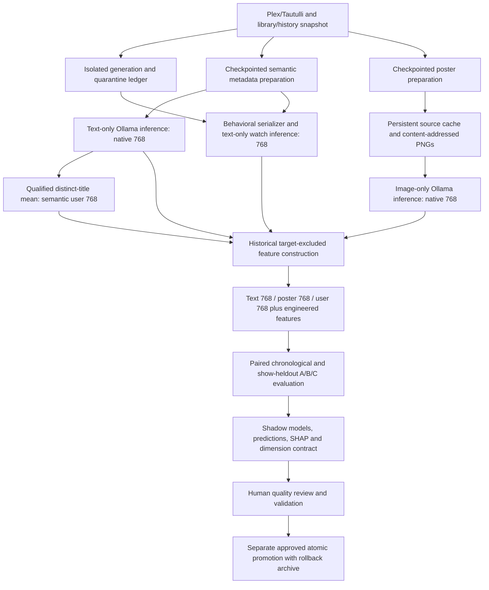

# EmbeddingGemma 2 independent text/poster migration

**Production deployment, November 5, 2026:** text-only B is published with 1,536 embedding dimensions and poster inference disabled. The authorized retirement and single production catch-up also completed. See [the execution report](embeddinggemma2-text-production-completion.md) and [physical text-only cutover runbook](embeddinggemma2-text-production-cutover.md). The independent poster/C procedures below remain historical research instructions; they are not the daily production contract.

## Historical independent-modality refactor — November 3

Implementation and bounded validation: **November 3, 2026, birch**. The canonical architecture is now **independent metadata-text and poster-image embeddings**, superseding the earlier joint-inference migration. **GO for a manually controlled full shadow rebuild; NO-GO for production promotion pending full population validation, model-quality review and explicit user approval.** No production backfill, production model training, activation, configuration change, schema installation, service restart or commit was performed during this refactor.

Each media record retains two complete native **768-dimensional** representations. User profiles remain 768-dimensional semantic preferences derived from media **text** vectors. Watch vectors remain 768-dimensional behavioral text. XGBoost receives **2,304 embedding features**, followed by engineered features. Concatenation exposes separate modalities to the classifier; it is not a learned fusion encoder. No averaging, projection, truncation, SHAP pruning or joint inference occurs in the canonical media path.

The existing generation infrastructure was refactored rather than replaced: immutable model identity, independent preparation checkpoints, persistent artwork cache, source snapshots, provenance, historical quarantine, leakage protection, shadow artifacts, atomic publication and verified rollback remain. The original joint experiment remains isolated under `experiments/multimodal-single-record/`; historical joint-generation rows are preserved and cannot serve as independent-vector reuse parents.

## Architecture and source references

References reviewed: [architecture audit](media-embedding-architecture-audit.md), [single-record measurements](../experiments/multimodal-single-record/README.md), its [experiment script](../experiments/multimodal-single-record/experiment.py), the prior migration implementation/tests, and the MPNet serializer immediately before `756ec915595030a1d9737668d49b339313f24148`. MPNet supplied title, year, genres, actors, directors, runtime and synopsis. This serializer restores those inputs and adds explicitly sourced television context. The audit's title/summary-only legacy encoder and incomplete `watch_sim` exclusions are not carried into the new feature contract.



| Source | Responsibility |
|---|---|
| `api/embedding_generation/contracts.py` | Semantic/behavioral serializers, per-modality contracts, immutable encoder, hashes and dimensions |
| `source.py`, `history_scope.py` | Read-only inventory, event availability, quarantine and existing-vector coverage |
| `io.py` | Plex reads/cache, image validation/preprocessing, immutable-digest Ollama requests |
| `store.py`, `validation.py` | Independent vectors, dependencies, resume/reuse, coverage and artifact integrity |
| `backfill.py` | `prepare_metadata`, `prepare_posters`, `run_media_text`, `run_media_poster`, `run_watches`, `run_users` |
| `features.py`, `evaluation.py`, `model.py` | Shared historical features, fold-only vocabulary, A/B/C metrics, separate classifiers and scoring |
| `operator.py` | Durable state-bound review gates, progress and stage-run checkpoints |
| `promotion.py`, `runtime.py` | Atomic publication/undo, writer barrier, active-generation routing and deployed-code receipt |
| `scripts/embeddinggemma2_migration.py` | Independently invoked manual CLI stages and post-cutover daily orchestration |
| `api/services/dimension_config.py`, `dimension_explorer.py`, `frontend/src/pages/AdminDimensions.tsx` | Explicit text/poster/user groups and separate contribution reporting |

Small guards in the legacy embedding, user, training, scoring and dimension-labeling entrypoints preserve inactive behavior and refuse legacy writes after activation. `fetch_tautulli_data.py --no-embeddings` allows source ingestion without invoking the old encoder. `run_daily_pipeline.sh` and the application pipeline route to the new daily path only after activation. Docker remains a distribution artifact; the deployment target remains the existing systemd backend.

## Encoder and independent inference contracts

Observed Ollama endpoint: `http://192.168.1.123:31770`, version **0.40.13**. Existing installed model: **`embeddinggemma-2:latest`**, variant **`embeddinggemma-2:740m-q8_0`**, quantization **Q8_0**. No model download, new provider or extra inference server was introduced.

- Immutable model SHA-256: `f4981a15b99858ad1f2e0729416e526be7b4f428291b40082b9e4f7b27b5f62f`.
- Projector-information SHA-256: `aa51094230ca75d57fa120c04613b4c93acb31399dad534bd3bcec67e683e297`.
- Validated request reference: **`sha256:<digest>`**, not `name@sha256:...` (the latter was rejected by this server).
- Advertised embedding/vision capabilities and projector identity are checked against the manifest. Model name, digest, variant, output dimensions and normalization policy are persisted. A validated reuse parent pins its encoder directly instead of resolving a possibly changed `latest` alias.

Text requests to `/api/embed` use `input: {"text": "<canonical text>"}`. Poster requests use `input: {"image": "<base64 prepared PNG bytes>"}`. `Ollama.embed()` rejects both inputs together and rejects an empty request. Both request `dimensions: 768`, `truncate: false`, `keep_alive: "15m"`, and pinned defaults `options: {"num_ctx":8192,"num_thread":16,"num_batch":2048}`. A separately validated poster-only `--num-thread` execution override leaves these original contract/hash anchors unchanged; see [operational CPU thread control](embeddinggemma2-thread-control.md). Overlong inputs fail rather than silently truncating. Thread options are requested settings, not measured CPU utilization. Output must be a single finite, nonzero 768-vector; native text/image/watch norms are checked against the unit-norm policy. Equal width never permits cross-generation reuse.

| Contract | Version / dependency |
|---|---|
| Representation | `independent-text-poster/1.0` |
| Metadata serializer | `plexintel-media/2.1` |
| Poster preprocessing | `exif-rgb-png-max1536/1.0` |
| Behavioral serializer | `plexintel-watch/2.0` |
| Semantic profile | `rating-key-text-mean/2.0` |
| Feature schema | `independent-text-poster-user-prospective/3.0` |
| Label policy | `legacy-engagement-060/1.0`; existing active 0.60 behavior preserved |
| Quarantine | `library-linked-unembedded-quarantine/1.0` |
| Missing artwork | `null-image-vector-xgboost-missing-indicator/1.0` |

Per-modality contract hashes deliberately include only relevant dependencies. Changing the metadata serializer invalidates text, semantic-dependent watch inputs and users, without invalidating unchanged image inference. Changing preprocessing/projector identity invalidates image vectors. Changing the encoder digest invalidates all encoded populations. Feature-schema or label-policy changes invalidate dependent datasets/models, without needlessly re-encoding identical inputs. The overall generation contract still versions the coherent downstream unit.

## Canonical metadata specification

`plexintel-media/2.1` is a version line followed by compact canonical UTF-8 JSON: sorted object keys, NFC text, collapsed whitespace, finite numeric values, explicit `null` and empty arrays. SHA-256 covers the complete serialized input. Unordered named lists are deduplicated and sorted; cast retains credited order, source order breaks ties, with a documented **20-person** limit. Missing credit order uses Plex return order. Text fields over 50,000 characters fail. A missing title, unsupported type or absent verified parent-show context fails preparation instead of inventing content.

| Canonical information | Source / handling |
|---|---|
| Type, title, original title, year, runtime | Plex `type/title/originalTitle/year/duration`; duration converted from milliseconds to minutes |
| Synopsis, genres, tagline, content rating | Plex summary, Genre, tagline, contentRating |
| Cast, directors, writers, creators | Role, Director, Writer, Creator; source absence remains explicit |
| Studio and production companies | studio, ProductionCompany when supplied |
| Countries, original/audio languages | Country, originalLanguage, audio Stream language attributes when supplied; audio language is distinct from original language |
| Collections/franchise context | Plex Collection membership; no fabricated franchise taxonomy |
| Show context | Verified parent show's title/original title, year, synopsis, genres, cast, creators, writers/directors, studio/production, countries/language, collections and content rating |
| Season context | For episodes, verified season title, synopsis, year and index when retrievable |
| Season/episode position | Explicit season number, episode number, episode title and synopsis; movie/show/season/episode handled separately |

The richer raw Plex response and prepared semantic payload live in generation source JSON/preparation records; the legacy `library` schema is not expanded or filled with invented values. Plex/Tautulli availability is not equivalent to populated fields: creators, production companies and original language can remain empty in actual Plex metadata. Technical media filenames, users, viewing outcomes, completion, audience/critic ratings, votes and popularity are excluded from intrinsic media text. The separate behavioral serializer keeps duration/completion and event context but omits usernames from encoder input.

## Poster preparation, cache and missing-art policy

Poster preparation is a distinct producer with its own checkpoints, failures and timing. It makes no Ollama requests. Text inference never downloads posters. Image inference consumes only prepared cached bytes.

The hierarchy is versioned: **movie self; show self; season self then show; episode show then season then self**. Parent identities are verified; the same hierarchy is used for preparation, training and candidate scoring. A changed hierarchy contract invalidates the relevant preparation/input identity.

Cache entries persist source identity, source reference/revision information, ETag/Last-Modified when available, original byte hash, prepared content hash and cache path. Positive cache freshness is **24 hours**; negative cache freshness is **1 hour**. Expired entries revalidate conditionally where supported. An explicit `--force-poster-check` bypasses freshness and deduplicates shared source identities within that preparation run. Changed revision/reference information also causes preparation to reconsider the source. A server with no validators can require downloading again after expiry; detection is bounded by scan/cache cadence, not instantaneous.

Retrieval uses bounded timeouts/retries, refuses redirects, validates JPEG/PNG/WebP MIME against decoded format, maximum **16 MiB**, **20 million pixels**, and one frame. Preprocessing applies EXIF orientation, RGB conversion, aspect-preserving longest edge at most **1536**, then deterministic PNG encoding. Ollama owns its model-specific image transform. Files are content-addressed and atomically cached, so shared show art is not unnecessarily duplicated. Cache reuse is not reuse of the vision encoder's internal computation: **persisted compatible image vectors**, rather than downloaded files alone, avoid image inference.

Missing/inaccessible artwork after the fallback hierarchy becomes explicit `missing_art` provenance. `media_poster.embedding` is **SQL NULL**, status **`missing`**, with no fabricated image output dimension or native-image success claim. The classifier receives 768 missing-value slots (NaN in its matrix) plus `poster_missing=1`; XGBoost applies its learned missing branches. These slots are not persisted as a zero vector. Default acceptance limit is **zero**: any exception requires the operator to review coverage and explicitly accept a numerical missing-art limit. Preparation/source failures remain failures; they cannot bypass a stage merely because missing art is an accepted policy.

## Persistence, invalidation and lineage

Optional manual migrations are [001](../api/db/migrations/optional/embedding_generation/001_generation.sql) and additive [002](../api/db/migrations/optional/embedding_generation/002_independent_modalities.sql). They are outside automatic application schema installation. **Neither has been installed in production during this refactor.**

`embedding_v2.generations` stores immutable contract, source snapshot, expected counts, optional validated parent and validation/activation state. `items` has independent kinds `media_text`, `media_poster`, `watch`, `user`, keyed by generation/kind/entity. Each records model/variant/digest via its contract/provenance, modality contract hash, independent input hash, vector(768), normalization, timestamp, status, errors, origin generation and source/poster provenance. `dependencies` records same-generation media-text lineage for watch/user outputs. Historical `media` rows remain retained and incompatible with the new representation.

`preparations` separately checkpoints metadata and poster stages. `poster_cache` stores persistent source cache identities. `preparation_attempts` and `inference_requests` retain cumulative attempt timings even when a current checkpoint is superseded. `stage_runs` and `operator_reviews` make progress/review decisions durable. `modality_training_rows` stores all three native vectors separately, a nullable image vector, explicit boolean missing flag, label/availability times, engineered features and dependency lineage. Old joint-generation `training_rows` remains historical.

| Change | Recompute / invalidate | Reuse |
|---|---|---|
| Canonical semantic metadata | Text; affected behavioral inputs, semantic profiles and model/scoring artifacts | Unchanged compatible poster vector |
| Prepared image pixels | Poster and dependent dataset/model/scoring artifacts | Text, watch and semantic user vectors |
| Neither input/contract changes | No media inference | Both modalities |
| Model digest | All affected encoded populations, users and downstream artifacts | No old-encoder vectors |
| Behavioral event correction | Affected watch input, profiles/labels/features as applicable | Unrelated text/poster inference |

Source reconciliation is explicit. Metadata and poster hashes are independent; identical pixels can preserve image inference despite a reference/revision change. Every eligible item gets **both new modalities during the initial no-parent migration**. Later generations may copy only matching inputs and matching per-modality contracts from a **validated independent** parent, recording origin lineage. Validation checks actual vectors, identities, provenance, expected populations, input hashes, dependencies, normalization and model artifacts, not just success flags. Generation builders cannot consume legacy vectors or infer compatibility from width.

Watch history coverage currently remains **9,860 source events = 9,586 eligible + 274 quarantined**, the latter representing **153 absent titles**. All **9,586 existing watch vectors** are eligible; new library-linked events are additionally included on refreshed inventory. Unlinked events with an existing vector fail for recovery rather than being quarantined. The approved ledger is preserved in the snapshot with a hash and aggregate coverage proof. No source rows are deleted.

User qualification remains engagement ratio **strictly greater than 0.5 OR at least five events**, followed by distinct rating-key deduplication and an equal mean of qualifying **text** vectors. The resulting mean is not renormalized; inference cosine normalizes when needed. No weighting change was introduced. All **31 current qualifying users** must be rebuilt. These are semantic preferences, not independently learned visual preferences. `visual_user_profile` remains explicitly absent; a future separately versioned visual-profile kind would depend on poster hashes and require new evaluation/approval, feature schema and migration. It is not implemented or activated here.

## Feature contract, leakage protection and evaluation

The full classifier C uses exact ordered columns:

1. `media_text_0` through `media_text_767` (indices 0–767).
2. `media_poster_0` through `media_poster_767` (768–1535).
3. `user_0` through `user_767` (1536–2303).
4. Fold-fitted `genre_*`, `director_*`, `decade_*`, then `watch_sim`, `poster_missing`.

All 768 native dimensions remain available in each group whether or not a tree splits on them. The B text-only classifier omits the image group and missing-art indicator from its **design matrix**, not from stored embeddings. Its user group follows the text group. Model bundles explicitly pin feature names/order/width, representation, model/dataset generation and vocabulary. Load/scoring rejects mismatch. Genre engineered features use parent-show genres when episode genres are absent; the intrinsic serializer still records absence and separate parent context explicitly.

Training-time user profiles exclude the target rating key and, for the show-heldout evaluation, every heldout show's eligible events. Watch-similarity profiles exclude target-title events and future activity. History requires the watch timestamp and its verified completion/availability timestamp strictly before prediction time; when completion is unknown, the first source-observation time is the conservative fallback. Unchanged events retain their earliest known observation time across parent refreshes. Watch similarity is **behavioral text versus media text** cosine over eligible history, never watch-text versus poster-image cosine. Eligibility uses the documented existing 0.5 behavioral threshold. Empty similarity history yields zero; no semantic history means the candidate cannot be scored and is counted as excluded. Production and training call the same feature constructor with their respective cutoffs and target exclusions.

`train` produces paired chronological and additional show-heldout comparisons:

| Arm | Representation | Purpose |
|---|---|---|
| A corrected legacy | Stored legacy media/watch vectors; corrected historical profiles/features | Separate leakage-rule effects from encoder changes |
| Legacy unsafe control | Stored legacy vectors and retained old-style profile rules | Quantify leakage correction within available legacy coverage |
| B E2 text | Complete semantic text, new watch/user vectors, no poster features | New text representation |
| C E2 text + poster | Identical B rows, folds, user/watch inputs and engineered features, adding image group/indicator | Incremental poster value |

Vocabulary is fit only on each training fold. B/C cohort hashes and row counts must match in both evaluations. Evaluation reports balanced accuracy, precision/recall, PR-AUC and average precision, ROC-AUC where both classes exist, Brier score and 10-bin calibration diagnostics, NDCG@10, Recall@25, prediction/training latency, movie/TV, missing-art, sparse-history and unseen-training-title slices. Empty slices are explicit. Ranking is among labeled heldout candidates per user, not full-catalog retrieval; Recall@25 can saturate for small cohorts. Zero-history users are unscored and separately reported. Grouped gain and validation SHAP magnitudes are associational diagnostics, not causal evidence or justification for pruning embeddings.

Historical caveats remain: current enriched metadata/artwork is not a point-in-time historical snapshot; label observation horizons vary; legacy vector model/serializer lineage was not fully versioned. Report these limitations with A/B/C results. The legacy 0.70 configured versus 0.60 active label discrepancy is reconciled explicitly: this generation preserves active **0.60** labels and versions that policy; promotion aligns the configuration to 0.60 atomically and archives the prior setting. Label-policy experiments must remain separate.

Generation-specific artifacts include `text_model.pkl`, full `model.pkl`, `dataset.json`, `evaluation.json`, `scoring.json`, and `dimensions.json`. None replaces the legacy `xgb_model.pkl`. The Dimension Explorer reads explicit group ranges/names and reports text/poster/user SHAP groups separately. Per-prediction retained SHAP can be partial; aggregate validation group importance uses the full design matrix. Legacy semantic dimension labels are archived on publication and not reused; the old semantic labeler is blocked for this schema. New dimensions are intentionally unlabeled until a compatible labeling workflow is evaluated, while raw feature identities and SHAP remain inspectable.

For compatibility with existing API readers, atomic publication projects **text768** into public `media_embeddings`, watch768 and user768 into their existing tables. Public `training_data` remains a clearly designated **1536 text/user diagnostic projection**; the new classifier trains exclusively from `modality_training_rows` with the 2304 schema. This compatibility table must never be mistaken for C's training input. Explanations and active dimension configuration use the full new classifier ordering.

## Measured validation and resource planning

Evidence: `artifacts/embeddinggemma2/independent-preflight.json`, `independent-integration.json`, `test-validation.json`, `manual-runbook-validation.json`, and `production-boundary-check.json`. These artifacts contain no credentials or saved vectors. The real integration fixture uses private temporary PostgreSQL tables/sequences and the existing Plex/Ollama endpoints; those tables disappear when the connection closes.

The bounded cohort includes **8 real media identities** (movies, episodes and parents), **4 watch events**, and **1 semantic profile**. One real movie is held out initially, then admitted to exercise new-title generation. Controlled metadata omission, alternate actual artwork and missing-reference fixtures change only private source records, never Plex. The harness issues **9 text + 9 image + 5 watch = 23 actual requests** including refresh scenarios. All eight images are generated before the controlled missing-art case; final checkpoint coverage is 8 text, 7 image plus 1 explicit missing, 4 watch and 1 user. It is not a full-population or recommendation-quality test.

Real cases enforced: metadata-only change → one text/zero image requests; poster-only change → one image/zero text; unchanged → zero media requests; new title → both; interrupt immediately after committed text checkpoint → zero repeated inference on resume; missing poster → no inference and explicit NULL/missing policy. Text/watch semantic alignment is checked within the same pinned encoder, without using image/watch cosine or asserting recommendation accuracy.

The final bounded run finished at **2026-11-03 19:00:15 UTC**, in **75.21 seconds**. All 23 requests returned finite, nonzero native 768-vectors. The four watch vectors each ranked their own media-text title first among the four eligible cohort titles (cosines 0.959–0.983); this is a limited alignment sanity check, not predictive-quality evidence.

| Modality | Actual requests | Mean client time | Median server non-load time | Mean server non-load time | Reported load, total / maximum | Token range |
|---|---:|---:|---:|---:|---:|---:|
| Media text | 9 | 0.329 s | 0.290 s | 0.324 s | 0.015 / 0.005 s | 271–584 |
| Poster image | 9 | 6.683 s | 6.141 s | 6.639 s | 0.290 / 0.064 s | 604–676 |
| Watch text | 5 | 0.379 s | 0.317 s | 0.375 s | 0.006 / 0.004 s | 304–605 |

These are different real inputs and controlled refresh cases, not three identical-record latency repetitions. The earlier single-record report provides the repeated-record comparison. Cumulative per-item metadata preparation was **0.129 s over 9 preparations**, poster retrieval **0.105 s** and image preprocessing **3.329 s over 10 preparations**. The fixture mixes actual retrievals with same-run source-cache reuse; content-addressed files already existed from prior bounded runs, while its source-cache database entries were private to this connection. Preparation totals exclude inventory scan/setup time and are not full-library download estimates. The final semantic-profile mean took **0.000465 s**; snapshot/DB/stage overhead is included in the 75.21-second whole-fixture runtime. Actual request ledgers total **2.958 s text + 60.148 s image + 1.893 s watch** of client inference time.

Ollama timing is `total_duration - load_duration`, which includes server preprocessing/pooling and is not isolated kernel time. Client wall time includes HTTP. The model was resident: **true cold-start load is N/A** for this run. Reported per-request load overhead is listed separately. `/api/ps` reports **634,461,879 bytes**, VRAM zero; this is a resident allocation snapshot, not measured peak remote RSS or total host memory. Peak resource use and competing-server impact remain unmeasured.

Final regression: **761 passed, 224 skipped, 89 subtests passed, one pre-existing FastAPI deprecation warning, in 88.85 s**. The **77 migration-specific cases** are included in that suite. This includes temporary-PostgreSQL model fitting/publication/rollback fixtures, full native-width feature and missing-art checks, provenance/invalidation, historical cutoffs, target/show exclusions, resume/idempotency, failure accounting, operator gates, source-collection progress, stage independence, and existing API/application regression coverage. Skipped tests remain environment/optional-suite exclusions; passing tests do not imply those skipped scenarios ran. The focused database/independence run passed **40 tests** before the final runbook/progress tests were added. **46 documented migration commands** passed actual parser validation; `--help`, shell syntax and `git diff --check` passed. TypeScript and Vite built successfully into `/tmp/plexintel-independent-ui-dist`; the served frontend was untouched. The existing stale Browserslist notice was not addressed by installing dependencies.

The final read-only production check confirmed **8,393 media, 9,586 watch and 31 user production vectors**, unchanged training/prediction counts, unchanged `.env`/legacy model hashes, absent optional migration schema/activation markers, and the same active backend PID **1637**, restart count **2**. No production service was restarted. Source implementation changes are present for review; full replacement populations and real-data classifier-quality results are still pending.

Initial scope: **8,393 text + 8,393 poster + 9,586 watch + 31 user outputs**, subject to refreshed inventory. At the measured mean client latencies, serial inference extrapolates to **17.36 hours** (about 0.77 h metadata, 15.58 h poster, 1.01 h watch). Plan approximately **20–26 hours of processing**, plus manual review pauses and separately measured model fitting/scoring; this is a small-cohort estimate, not a capacity guarantee. Source length, image resolution, cold loads, cache misses, retries and shared-server load can change it substantially. Start with **one serial Ollama request at a time**; requested 16 threads is not a concurrency benchmark. Poster cost dominates; daily metadata-only refreshes avoid it entirely. Full model-fitting RAM/latency and full-library missing-art coverage remain approval-stage unknowns. Disk preflight showed about **839 GB** free in this project filesystem; PostgreSQL/WAL capacity and retained rollback archives must also be assessed on their actual storage volumes. Allow multiple GiB for native vectors, training rows, lineage, rollback data and cached images; this is not a measured complete storage budget.

Daily reporting separates metadata/image/watch inference counts and seconds, profile rebuild count/time, inherited compatible outputs, cumulative preparation timings and total runtime. `inference_requests` is an attempt ledger, so changed/failed/retried items are not hidden by final row counts. Post-cutover daily generations reuse unaffected compatible vectors; image-only changes do not re-encode watch or semantic profiles. New classifier/scoring artifacts are rebuilt against the coherent generation and quality gates remain enforced.

## Manual Operator Runbook — Complete Step-by-Step Migration

**Primary operating mode: one explicit command at a time in an SSH terminal on birch.** The operator executes these commands after review; the assistant has not executed the full migration. No stage launches the next major stage. `--approved-production-change` authorizes only the named command; it does not authorize promotion or a restart. Read-only inspections can write a requested local report file but do not modify the database.

Concise reference:

| Command | Effect | Safe repetition / restart |
|---|---|---|
| `preflight`, `coverage`, `status`, `inspect`, `export`, `verify` | Read-only database/API inspection or artifact export | Repeat; no restart |
| `install` | Optional additive production schema and installation marker; no activation | Idempotent; explicit approval; no restart |
| `create` | New shadow snapshot/manifest, independent item seeds; no inference | Creates a new ID each time; resume using existing ID instead |
| `metadata`, `posters` | Shadow preparation/cache; Plex retrieval only | Checkpointed; use refresh flags for source changes |
| `recover-metadata` | Explicit recovery of failed historical metadata; verified Plex identities or stored fields; no inference | Checkpointed, requires a recorded reason; no restart |
| `media-text`, `media-poster`, `watch` | Only the specified shadow modality's Ollama inference | Resume skips compatible completed outputs |
| `users` | Shadow text-derived user means; no Ollama or classifier training | Compatible completed profiles skipped |
| `refresh-source` | Atomic shadow inventory/history reconciliation | Repeat; preparation/inference remain separate |
| `review` | Durable human gate, bound to current inputs/artifacts | Repeat only after actual inspection; changed inputs stale old reviews |
| `train` | Shadow dataset, paired model fits/evaluation and dimension contract | Rebuilds derived artifacts; no active model training |
| `score` | Shadow predictions and SHAP | Repeat; no activation |
| `validate` | Shadow completeness/provenance/quality checks; freezes valid generation | Never promotes; immutable afterward |
| `promote` | Atomic active-generation publication and rollback archive | Separate approval/deployment receipt; not a routine retry |
| `rollback`, `recover-transition` | Explicit verified active-state restoration / crash-marker recovery | Separate approval; inspect current state first |

### 1. Preflight and scope review — read-only

```bash
cd /home/jmnovak/projects/plexintel
plexenv/bin/python scripts/embeddinggemma2_migration.py --help
plexenv/bin/python scripts/embeddinggemma2_migration.py preflight --output artifacts/embeddinggemma2/operator-preflight.json
plexenv/bin/python scripts/embeddinggemma2_migration.py coverage --output artifacts/embeddinggemma2/operator-coverage.json
```

Review digest/variant, endpoint/version, disk/WAL capacity, current pipelines/resource competition, target populations and quarantine. All existing watch vectors must be covered. The accepted unlinked historical exceptions must remain exactly accounted for; new anomalies require review rather than fabricated source data. **Stop here for the preflight/scope decision.** No inference has run.

### 2. Install optional schema, then create a shadow generation

Run only after manually approving scope/resources. Schema installation changes the database schema, not active embedding values. The marker tells guarded processes that the optional schema exists; it does not activate a generation.

```bash
plexenv/bin/python scripts/embeddinggemma2_migration.py install --approved-production-change
plexenv/bin/python scripts/embeddinggemma2_migration.py create --approved-production-change
```

Copy the emitted generation ID. Keep the same ID for every stage/resume. Do not repeatedly run `create` when resuming. Set the initial missing-art budget to zero; change it only after inspecting actual exceptions and recording the decision.

```bash
GENERATION_ID='<copy the emitted generation UUID>'
MISSING_ART_LIMIT=0
plexenv/bin/python scripts/embeddinggemma2_migration.py status --generation "$GENERATION_ID"
```

### 3. Prepare metadata, generate only text, then review

```bash
plexenv/bin/python scripts/embeddinggemma2_migration.py metadata --generation "$GENERATION_ID" --approved-production-change
plexenv/bin/python scripts/embeddinggemma2_migration.py inspect --generation "$GENERATION_ID" --item-key 3 --output artifacts/embeddinggemma2/operator-input-3.json
plexenv/bin/python scripts/embeddinggemma2_migration.py media-text --generation "$GENERATION_ID" --approved-production-change
plexenv/bin/python scripts/embeddinggemma2_migration.py status --generation "$GENERATION_ID"
```

`3` is a real movie identity in the bounded cohort; select another identity from inventory if it is no longer present. Inspect canonical fields and representative movie/show/season/episode inputs, provenance, 768 dimensions, normalization, counts and errors. Failed/incomplete metadata blocks text inference; failed/incomplete text cannot pass its gate. After inspection:

```bash
plexenv/bin/python scripts/embeddinggemma2_migration.py review --generation "$GENERATION_ID" --gate text --reason 'Reviewed complete semantic inputs, text coverage and vector provenance' --approved-production-change
```

#### If metadata preparation reports Plex HTTP 404

`inspect` proves only that item's preparation state. The inference gate requires every expected metadata checkpoint. `status` reports `preparation_counts`, `preparation_errors` and retryable failures. A 404 may indicate a changed Plex rating key or content removed from Plex while PlexIntel retains its metadata/history. Retrying cannot restore a deleted identity.

The operator approved **`verified-plex-or-stored-history/1.0`** for this case. The separate recovery command retries failed 404 records and previously attempted recovery failures; it does not rewrite successful checkpoints, invoke Ollama, prepare/download posters, drop records or alter production library/watch identities. It first tries the original identity, then an exact stable GUID of the same media type. A season may additionally match by a verified parent-show GUID plus season index. Ambiguous candidates, mismatched identities and transient API failures remain errors; titles alone never authorize a match.

When content is genuinely gone, recovery uses the captured library title/synopsis/year/runtime/hierarchy and read-only stored genre, ordered cast and director associations. Previously captured rich canonical fields are retained when available. Unrecorded fields remain null/empty; stored associations can contain prior importer inheritance or stale tags, which is explicitly attributed. TV children retain recorded parent context, using verified current parent metadata when available or attributed stored parent fields otherwise. Current artwork from a verified same show can be used by the existing TV hierarchy; inaccessible artwork still follows the explicit missing-art policy and acceptance gate.

For generation `070e323c-b2ee-40c9-aaed-931d8fa58f8d`, read-only diagnosis found **8,315 successful + 78 failed metadata records**: Love Island USA (one show, two seasons, 73 episodes), one The Pitt episode and one Lioness episode. All 78 have existing media vectors and their history includes **110 existing watch vectors**. These are preserved in the rebuild; the approved quarantine for 274 previously unembedded unlinked events is unchanged. Love Island USA's old show key `33211` now resolves by the same stable GUID to `38511`, whose current library has just one episode. Remapping the show therefore cannot restore all old episode metadata.

Run recovery manually, inspect status/origins, then retry text inference only after metadata is complete:

```bash
plexenv/bin/python scripts/embeddinggemma2_migration.py recover-metadata --generation "$GENERATION_ID" --reason 'Approved verified Plex identity recovery and attributed stored metadata for removed historical titles; preserve all existing vectors and history' --approved-production-change
plexenv/bin/python scripts/embeddinggemma2_migration.py status --generation "$GENERATION_ID"
plexenv/bin/python scripts/embeddinggemma2_migration.py inspect --generation "$GENERATION_ID" --item-key 33213 --output artifacts/embeddinggemma2/operator-recovered-33213.json
plexenv/bin/python scripts/embeddinggemma2_migration.py media-text --generation "$GENERATION_ID" --approved-production-change
```

Recovery records the policy, operator reason/time, original/resolved keys, stable identity evidence, per-component metadata sources and a hashed input snapshot. `inspect` exposes `metadata_origin` and `metadata_recovery`; `status.metadata_sources` summarizes recovered sources. Final validation reserializes attributed inputs and checks their hashes, policy and identities. The serializer remains `plexintel-media/2.1` because its format is unchanged; recovery is a separately versioned source policy, not a silent serializer change. Metadata/poster hashes remain independent.

Rerunning `recover-metadata` skips completed recoveries. Later explicit metadata refreshes and validated-parent incremental generations retain the approved recovery policy, retry current Plex resolution, and invalidate vectors only when actual semantic/art inputs change. New, unapproved historical failures still require the separate manual recovery command. Successful preparatory recovery does not itself generate or verify replacement vectors. Continue with the text review gate after text inference, then poster preparation/inference and the remaining independent stages.

Recovery follow-up validation: **769 passed, 224 skipped, 89 subtests passed, one existing warning, in 91.98 s**; **50 focused generation/database tests passed**. All **50 documented commands** passed parser checks. A private two-record real Plex fixture verified GUID replacement, historical fallback and zero-request resume, with zero image or embedding requests. A read-only preview of six actual failed records found four verified replacement identities (including The Pitt and Lioness episodes) and two historical fallbacks. Evidence is in `metadata-recovery-integration.json`, `metadata-recovery-preview.json`, `metadata-recovery-validation.json` and `metadata-recovery-boundary.json` under `artifacts/embeddinggemma2/`. The operator generation remains at 8,315 successful / 78 failed preparations until the operator runs the new command. Recovery preserves historical representations; catalog cleanup or changes to scoring eligibility are separate decisions.

### 4. Prepare posters, generate only images, then review

```bash
plexenv/bin/python scripts/embeddinggemma2_migration.py posters --generation "$GENERATION_ID" --approved-production-change
plexenv/bin/python scripts/embeddinggemma2_migration.py inspect --generation "$GENERATION_ID" --item-key 3 --output artifacts/embeddinggemma2/operator-poster-3.json
plexenv/bin/python scripts/embeddinggemma2_migration.py media-poster --generation "$GENERATION_ID" --approved-production-change
plexenv/bin/python scripts/embeddinggemma2_migration.py status --generation "$GENERATION_ID"
```

Inspect hierarchy, source/content hashes, decoded dimensions, cache provenance, successes, failures and explicit missing artwork. Missing rows count separately from successful native image vectors. Zero is the default exception budget. If legitimate exceptions are accepted, set `MISSING_ART_LIMIT` to the reviewed maximum and make the reason specific. Do not classify temporary failure as valid missing art without reviewing the retrieval evidence.

For the current generation's overheating investigation, a bounded one-poster comparison validated 8 and 6 requested threads without changing any saved vectors. **Eight is the recommended first reduced setting**, with unmeasured thermal benefit; full evidence and receipt requirements are in [thread control](embeddinggemma2-thread-control.md). Keep the same generation ID and include the execution flag on every resumed command:

```bash
plexenv/bin/python scripts/embeddinggemma2_migration.py media-poster --generation "$GENERATION_ID" --num-thread 8 --approved-production-change
```

The existing receipt is already present for `070e323c-b2ee-40c9-aaed-931d8fa58f8d`. For another generation or a deliberately repeated comparison, pause inference first and separately run the bounded benchmark. It does not advance any checkpoint or overwrite any embedding:

```bash
plexenv/bin/python scripts/embeddinggemma2_migration.py benchmark-threads --generation "$GENERATION_ID" --item-key 103 --approved-production-change
```

```bash
plexenv/bin/python scripts/embeddinggemma2_migration.py review --generation "$GENERATION_ID" --gate poster --missing-art-limit "$MISSING_ART_LIMIT" --reason 'Reviewed image coverage, cache identities and explicit missing-art exceptions' --approved-production-change
```

### 5. Regenerate watches, rebuild semantic users, then review

Both media reviews are required. Watch generation does not encode posters; user reconstruction does not train a model.

```bash
plexenv/bin/python scripts/embeddinggemma2_migration.py watch --generation "$GENERATION_ID" --approved-production-change
plexenv/bin/python scripts/embeddinggemma2_migration.py users --generation "$GENERATION_ID" --approved-production-change
plexenv/bin/python scripts/embeddinggemma2_migration.py status --generation "$GENERATION_ID"
plexenv/bin/python scripts/embeddinggemma2_migration.py review --generation "$GENERATION_ID" --gate profiles --missing-art-limit "$MISSING_ART_LIMIT" --reason 'Reviewed all eligible watches, quarantine, qualifying users and text-only lineage' --approved-production-change
```

Require the refreshed expected counts, not merely zero exceptions. Every existing eligible watch must have a new digest/serializer/input provenance. Review all qualifying user identities/ownership and distinct-title arithmetic; no legacy media dependency is permitted.

### 6. Explicit source reconciliation before training

For a long-running migration, re-read inventory/history before training. This command changes only the shadow snapshot and item sources; it does not invoke any preparation or inference stage. Removed/orphaned identities fail for explicit reconciliation. Re-run preparation with refresh, then each modality and the reviews individually. Compatible outputs are reused, so this does not repeat all inference.

```bash
plexenv/bin/python scripts/embeddinggemma2_migration.py refresh-source --generation "$GENERATION_ID" --approved-production-change
plexenv/bin/python scripts/embeddinggemma2_migration.py metadata --generation "$GENERATION_ID" --refresh --approved-production-change
plexenv/bin/python scripts/embeddinggemma2_migration.py posters --generation "$GENERATION_ID" --refresh --approved-production-change
plexenv/bin/python scripts/embeddinggemma2_migration.py media-text --generation "$GENERATION_ID" --approved-production-change
plexenv/bin/python scripts/embeddinggemma2_migration.py review --generation "$GENERATION_ID" --gate text --reason 'Reviewed reconciled metadata and text coverage' --approved-production-change
plexenv/bin/python scripts/embeddinggemma2_migration.py media-poster --generation "$GENERATION_ID" --approved-production-change
plexenv/bin/python scripts/embeddinggemma2_migration.py review --generation "$GENERATION_ID" --gate poster --missing-art-limit "$MISSING_ART_LIMIT" --reason 'Reviewed reconciled image coverage and accepted missing-art budget' --approved-production-change
plexenv/bin/python scripts/embeddinggemma2_migration.py watch --generation "$GENERATION_ID" --approved-production-change
plexenv/bin/python scripts/embeddinggemma2_migration.py users --generation "$GENERATION_ID" --approved-production-change
plexenv/bin/python scripts/embeddinggemma2_migration.py review --generation "$GENERATION_ID" --gate profiles --missing-art-limit "$MISSING_ART_LIMIT" --reason 'Reviewed reconciled watches and semantic profiles' --approved-production-change
```

To deliberately bypass the poster freshness interval without doing inference:

```bash
plexenv/bin/python scripts/embeddinggemma2_migration.py posters --generation "$GENERATION_ID" --force-poster-check --approved-production-change
```

If that check changes image inputs, repeat `media-poster` and affected reviews before training. Metadata/poster source updates can stale prior reviews and downstream artifacts. After final validation a generation is immutable; a changed source requires a new generation. For later compatible incremental/shadow generations only:

```bash
plexenv/bin/python scripts/embeddinggemma2_migration.py create --reuse-generation "$GENERATION_ID" --approved-production-change
```

This emits a **new** ID; use it for its separate stages. Do not use this parent path for the initial full rebuild. A legacy or native-joint generation is rejected as a parent.

### 7. Train and inspect shadow A/B/C models

```bash
plexenv/bin/python scripts/embeddinggemma2_migration.py train --generation "$GENERATION_ID" --approved-production-change
plexenv/bin/python scripts/embeddinggemma2_migration.py export --generation "$GENERATION_ID" --artifact dataset.json --output artifacts/embeddinggemma2/operator-dataset.json
plexenv/bin/python scripts/embeddinggemma2_migration.py export --generation "$GENERATION_ID" --artifact evaluation.json --output artifacts/embeddinggemma2/operator-evaluation.json
plexenv/bin/python scripts/embeddinggemma2_migration.py export --generation "$GENERATION_ID" --artifact dimensions.json --output artifacts/embeddinggemma2/operator-dimensions.json
```

Review B/C cohort hashes/folds, corrected and unsafe legacy controls and coverage, both chronological/show-heldout metrics, calibration/ranking limitations, slices, missing-art performance, feature-group importance, label policy and latency. Training does not activate the classifier. No quality improvement is presumed. Define acceptable regressions and operational budgets before deciding GO; there is no fabricated automatic quality threshold. If results are unacceptable, stop and retain the shadow generation for investigation. If acceptable:

```bash
plexenv/bin/python scripts/embeddinggemma2_migration.py review --generation "$GENERATION_ID" --gate quality --quality-go --missing-art-limit "$MISSING_ART_LIMIT" --reason 'Reviewed paired A/B/C results and explicitly accepted quality and operational tradeoffs' --approved-production-change
```

### 8. Shadow scoring and final validation

```bash
plexenv/bin/python scripts/embeddinggemma2_migration.py score --generation "$GENERATION_ID" --approved-production-change
plexenv/bin/python scripts/embeddinggemma2_migration.py export --generation "$GENERATION_ID" --artifact scoring.json --output artifacts/embeddinggemma2/operator-scoring.json
plexenv/bin/python scripts/embeddinggemma2_migration.py status --generation "$GENERATION_ID"
plexenv/bin/python scripts/embeddinggemma2_migration.py validate --generation "$GENERATION_ID" --quality-go --missing-art-limit "$MISSING_ART_LIMIT" --approved-production-change
```

Review actual population identities/counts, vector integrity, provenance/dependency generation, output/model/feature compatibility, accepted missing-art coverage, predictions and explanation dimensions, and rollback readiness. **Stop after validation. A separate final GO and user approval are required before deployment/cutover.** Validation does not promote. No replacement population has been fully rebuilt or verified in this implementation session.

### 9. Approved deployment and explicit production cutover

Only after separate approval: deploy the reviewed backend/UI source under the existing systemd architecture. Build the UI to a staging directory, preserve the served build before replacing it, then restart the backend once to load the reviewed generation-aware code. These commands are documented for the operator and were **not** run against the served frontend or systemd service here. Use a unique backup directory and retain it for rollback.

```bash
cd /home/jmnovak/projects/plexintel/frontend
/opt/homebridge/bin/node node_modules/typescript/bin/tsc -b
/opt/homebridge/bin/node node_modules/vite/bin/vite.js build --outDir /tmp/plexintel-independent-ui-dist
cd /home/jmnovak/projects/plexintel
DEPLOYMENT_BACKUP="artifacts/embeddinggemma2/deployment-backups/$(date -u +%Y%m%dT%H%M%SZ)"
mkdir -p "$DEPLOYMENT_BACKUP"
cp -a frontend/dist "$DEPLOYMENT_BACKUP/frontend-dist"
cp -a /tmp/plexintel-independent-ui-dist/. frontend/dist/
sudo systemctl restart plexintel-backend.service
systemctl show plexintel-backend.service -p ActiveState -p MainPID -p NRestarts
```

Obtain the authenticated admin deployment receipt from `/api/admin/embedding-generation/status` using the existing login/session, after restart. The origin is reported by preflight (`plex.redirect_uri` origin; currently `https://plexintel.kabolly.com`). Save the JSON response as `artifacts/embeddinggemma2/deployment-receipt.json`. For a CLI request, use an existing private Netscape-format cookie file exported from that admin session; the command below does not create a login or print credentials. Replace the local path before running, and verify the result is JSON rather than an auth redirect.

```bash
ADMIN_COOKIE_FILE='<private path to existing authenticated admin session cookies>'
curl --fail --silent --show-error --cookie "$ADMIN_COOKIE_FILE" https://plexintel.kabolly.com/api/admin/embedding-generation/status --output artifacts/embeddinggemma2/deployment-receipt.json
plexenv/bin/python scripts/embeddinggemma2_migration.py promote --generation "$GENERATION_ID" --deployment-receipt artifacts/embeddinggemma2/deployment-receipt.json --approved-production-change
```

The receipt's load-time source hash must match the publisher's reviewed checkout. Publication acquires the existing pipeline lock, rejects running legacy writers, uses an exclusive transition marker, rechecks source/legacy-model identity and validated artifacts, archives rollback rows with checksums, and publishes complete vectors, predictions, SHAP, dimension config, compatible settings and active pointer **in one transaction**. Record the emitted **promotion ID**. No partial generation is intentionally exposed. The legacy model file stays untouched. A failure before commit rolls back database changes; an interrupted publication with an unexplained marker requires explicit recovery below.

### 10. Post-promotion verification — read-only, then manual acceptance

```bash
plexenv/bin/python scripts/embeddinggemma2_migration.py verify --generation "$GENERATION_ID"
plexenv/bin/python scripts/embeddinggemma2_migration.py status --generation "$GENERATION_ID"
```

Verify active model width/order, exact materialized text/watch/user vectors/counts, independent poster coverage, predictions and 2304 SHAP/config basis. Manually check authenticated recommendation/API behavior and the Dimension Explorer's separate groups. Scheduled daily operations should now route to the active generation's incremental path; do not start an extra daily job merely to test initial cutover. Monitor the next approved run's independent inference/reuse counts and quality gate results. Daily orchestration is allowed only **after** cutover and cannot replace these manual initial stages.

### 11. Explicit rollback and crash recovery

The rollback archive retains prior vectors, predictions, training diagnostic rows, explanation/dimension metadata, compatible configuration and active pointer. Archive checksums and unchanged legacy model identity are verified before restoration. Prior generations/models are not deleted. With the recorded promotion ID:

```bash
PROMOTION_ID='<copy the emitted promotion UUID>'
plexenv/bin/python scripts/embeddinggemma2_migration.py rollback --promotion-id "$PROMOTION_ID" --approved-production-change
```

Rollback is an atomic database operation protected by the pipeline lock/barrier and expected active state. Inspect status/receipt and application behavior after it. The new backend handles inactive legacy mode, so database rollback does not inherently require a restart. If reverting application/UI source too, restore the preserved served build from `DEPLOYMENT_BACKUP`, restore the reviewed prior source revision without overwriting unrelated work, and restart systemd only with separate approval. Do not uninstall the optional schema or delete archived data.

If a crash leaves `transition.json`, first confirm the publishing process is gone and inspect current state. Do not delete it manually or kill an unknown process. The explicit recovery command checks marker ownership/liveness and validates the committed generation state before removing a stale barrier:

```bash
plexenv/bin/python scripts/embeddinggemma2_migration.py recover-transition --approved-production-change
```

A live owner, inconsistent state or unverifiable recovery fails closed. A failed promotion is not permission to repeat it blindly; determine whether it committed, recover if necessary, then verify or roll back the recorded promotion.

### Interruption, retries and observability

Each inference/preparation stage prints stage/generation, expected/completed/failed/missing/remaining counts, retryable failures, records/minute, elapsed time, observed ETA, resumed/skipped/reused count, safe current identity and last sanitized error. `status` includes current preparation/vector counts, recent preparation/item errors, attempt timings, quarantine and recent persisted stage runs. Usernames/credentials are not printed in progress. SSH output is plain text, not an interactive dashboard.

Ctrl+C exits **130**. Re-run the exact same stage command and generation ID to resume; successful compatible text/image/watch/profile outputs are not recomputed. Failed records remain retriable and block review/downstream progression. A request interrupted before its checkpoint can have unknown server completion and may be repeated; this is not an exactly-once HTTP guarantee. Metadata/poster preparation checkpoints are independent. Snapshot creation/reconciliation is atomic and safely rerunnable if interrupted before commit. Model fitting is not resumable tree-by-tree; rerunning `train` rebuilds only derived datasets/models from stable vector checkpoints. Validation never starts promotion, and no manual stage invokes another major producer.

Documented migration commands are checked against the actual parser by:

```bash
plexenv/bin/python scripts/validate_embeddinggemma2_runbook.py
```

The checker parses commands without executing them. Regression tests also exercise stage independence, gates, interrupted resume, missing-art fallback, failure/retry accounting and promotion/rollback authorization.

## Outstanding decisions and cutover risks

- Full shadow coverage, real A/B/C predictive metrics, full fitting/scoring latency and full resource impact remain **pending manual execution**. Synthetic classifier tests establish contracts, not quality.
- Current metadata/artwork introduces retrospective temporal uncertainty; richer input does not guarantee better recommendations. Preserve the corrected legacy control and report leakage effects separately.
- Explicit missing-art acceptance and its prediction effect require human review. No fake image vector is accepted.
- Full deployment receipt and real post-cutover API/UI verification remain pending. Bounded tests and temporary-schema publication/rollback tests do not prove live promotion.
- Semantic dimension labels require a future compatible labeling workflow; old labels are deliberately not transferred. Feature identities and group SHAP are implemented now.
- One-at-a-time inference is the tested concurrency. Do not raise it based only on serial latency; measure competing-service impact first.
- Metadata revision/cache freshness is not a perpetual source audit. Use explicit reconciliation and forced poster checks when needed; review source removals rather than silently dropping populations.

The operator retains complete control over every initial stage and the final cutover. The implementation is technically ready for the full shadow rebuild, but production suitability depends on its measured quality, completeness and operating cost.
