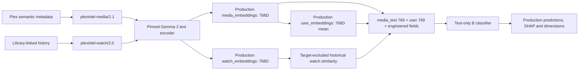

# EmbeddingGemma 2 text-only physical production cutover

Phases 2 and 3 were subsequently explicitly authorized, executed and verified on
2026-11-05. See [the production execution report](embeddinggemma2-text-production-completion.md)
for current identities, physical counts, retirement, backups and the separately
authorized single catch-up run. The inspection and Phase 1 results below retain
their original time-specific context; do not rerun adoption or cutover commands
against the already published release.

## Observed deployment — 2026-11-05

The supplied objective describes legacy production. Read-only inspection instead
found an existing completed C promotion at 07:30 America/Chicago:
`2a06966a-d84d-44f5-90a8-9ef11dcece66`, generation
`070e323c-b2ee-40c9-aaed-931d8fa58f8d`. `embedding_v2.control` points to it;
the generation is active, rather than merely validated. `ollama.embedding_model`
is already `embeddinggemma-2`; label configuration is `0.60`.

All **8,393 media-text, 9,586 watch, and 31 user vectors physically in production**
exactly match the validated generation, including full identity sets and every
vector value. All are 768D. The frozen library/history/feedback source hash matches
`ff6d8ce777360e08b56e50bd686ebfa2ed0b06639e9da045b5e4712acef2a2b6`.
No repeat Ollama inference is warranted. The original legacy model file is still
unchanged (SHA256
`d812b3660aec406c3b77b77fe3bcf2132ede7be01ed7b98a175e17bd67ccf3af`).
The original promotion archive preserves legacy vectors, training rows, predictions,
labels, configuration and explanation data. Its counts and content hashes were
recomputed and verified across all twelve tables, including 741,440 SHAP rows and
223,767 legacy recommendations. No model/pipeline jobs were running
at inspection; the backend service was active. These are time-specific observations,
rechecked before actual publication.

The active C artifact hash is
`1c92766c0f0b1f8d4625af779d238f2cc105c0361246138b24200f9080096e27`.
Evaluated B artifact `text_model.pkl` hash is
`40024c8f85cc29b13d4e2f911068895346a2e6e98a32ff9c43bc2b64af5e1477`.
The endpoint formerly reported only an active pointer/code receipt, not B/C identity.
The revised endpoint reports the verified canonical classifier identity and layout.

## Contract and architecture



`physical-text-production/1.0` pins `semantic-text-user-prospective/1.0`,
`poster_inference=disabled/1.0`, media-text then semantic-user, all 1,536 native
embedding features plus training-only-fitted genre/director/decade vocabulary and
`watch_sim`. Neither `media_poster_*` nor `poster_missing` may enter this model.
Existing rich intrinsic and behavioral serializers, model digest/variant,
normalization, label `legacy-engagement-060/1.0`, qualification/weighting, ownership,
quarantine and approved historical recovery remain unchanged. The vector modality
contracts/hashes stay compatible: changing the downstream layout is not a reason
to infer an identical media/watch vector again.

Text adoption creates a new reviewable release ledger, copies all three vector
populations and original inference lineage exactly, and adopts the *existing*
evaluated B booster. It rebuilds historical text features and checks exact B
matrix values, labels, weights and times against the original evaluated cohort.
The wrapper receives the new contract; its changed serialization hash does not
mean the booster was retrained. Original A/B/C evidence and C/poster vectors are
retained unchanged. New predictions/SHAP/dimensions are computed using B; none
are copied from C.

The canonical active model is physically persisted in
`embedding_v2.production_state` with its checksum, full contract and context.
`production_inputs` holds source/input hashes, original generation identities,
metadata, recovery records, timestamps and dependency lineage. Vectors are read
from the existing **public production vector tables**, not permanently redirected
to shadow vectors. Generation records retain immutable encoder-generation/evaluation lineage. Normal
production runs keep that same encoder generation and use only connection-private
working tables, plus durable run/delta checkpoints; no new permanent shadow
generation is created. `production_state.publication_id` identifies the current
model/data revision, independently of the fixed encoder-generation ID. Initial B
staging vector/training/prediction copies can be retired after verified backup;
canonical runtime reads do not depend on them. The unchanged old model file
is rollback evidence, not the active B classifier.

## Optional schema and affected paths

Operator-only migration `003_text_production.sql` adds `text_training_rows`,
`production_state`, `production_inputs`, and `production_rollback` under the existing
restricted schema. Addendum migration `004_production_runs.sql` adds durable
production-run delta/checkpoint journals and a publication revision identifier. No existing vector columns change. Application startup does
not install it. Source `model.py`, `features.py`, `validation.py`, `operator.py`,
`promotion.py`, `store.py`, `backfill.py`, `io.py`, `contracts.py`, the standalone CLI,
admin status route and dimension configuration support the explicit text contract.
`text_production.py` implements adoption, canonical model validation, physical
verification and archival restoration. `production_run.py` implements the
poster-disabled production orchestration, changed-input checkpoints, source sync,
normal quality-gated text refitting, scoring and atomic publication.

## Daily behavior and leakage

The existing systemd/application daily entrypoint routes to one text-only pipeline.
It loads physical production vectors and canonical provenance into temporary
working tables for the same encoder generation, reads current metadata/history,
and reuses compatible completed text/watch/user vectors. Checkpointed successful
inferences survive interruption; resuming a pending run skips completed stages
and does not repeat source synchronization. Source synchronization remains the
existing `fetch_tautulli_data.py --mode incremental --no-embeddings` path. The
normal text-only refit is explicit and cannot publish if chronological/show-heldout
quality gates fail. Publication archives the prior B revision and atomically
marks the production run successful. Rollback must target the latest publication
revision first, preventing accidental out-of-order restoration.
Metadata and watch corrections invalidate their actual descendants. Artwork is
not prepared, downloaded, hashed or inferred for ML; poster paths are excluded
from the text revision scan. Plex UI artwork endpoints remain unchanged. Direct
poster preparation/inference calls against a text contract fail closed.

Historical user and watch profiles exclude the target title, require activity
and observation availability before the prediction cutoff, and exclude heldout
shows during grouped evaluation. Vocabulary fitting uses each training fold only.
Daily text refits retain chronology and show grouping. Existing daily quality gates
retain the last good model if validation fails. No image work is silently enabled
when canonical text production is absent: daily fails with an adoption requirement.
SHAP matrices use two CPU threads; poster-specific `--num-thread` receipts do not
change the encoder identity or silently apply to behavioral inference.

## Recorded evaluation: selection is a cost/quality tradeoff

| Model | Chronological balanced accuracy | PR-AUC | ROC-AUC | Show-heldout balanced accuracy | PR-AUC | ROC-AUC |
|---|---:|---:|---:|---:|---:|---:|
| Corrected legacy A | .5400 | .9670 | .7392 | .6018 | .9844 | .8102 |
| Gemma 2 text B | .5796 | .9696 | .7592 | .6006 | .9837 | .7983 |
| Gemma 2 text + poster C | .5976 | .9679 | .7380 | .6155 | .9835 | .7809 |

Chronological test has 1,856 rows; show-heldout 447. B/C comparisons use matched
cohorts. B did not win every metric: C had higher balanced accuracy; B had higher
PR-AUC and ROC-AUC in these recorded comparisons. Text-only selection avoids
recurring image cost; it is not a claim that removing posters improves all
recommendation outcomes. Existing calibration, slices and ranking limitations
remain in immutable evaluation evidence; metadata lacks point-in-time snapshots.

## Atomic publication and rollback

The existing pipeline file lock, legacy-writer detection, transition marker,
PostgreSQL advisory lock, source locks and table locks guard publication. The
publisher checks source hash, base generation, current code receipt, validated
model/feature hashes and vector populations. It archives the entire current C
production state and canonical runtime/model/control state with verified hashes,
then replaces media, watch, user, diagnostic training, predictions, SHAP and
active dimension configuration in one transaction. It compares **every** production
vector and exact key set with the validated staged source before commit, and
publishes the model/pointer in the same transaction. Readers retain their prior
MVCC view until commit. No Ollama call occurs during promotion.

B rollback restores C's exact vector/prediction/training/explanation tables,
control, active configuration and model/context archive. Inactive newer dimension
configurations remain as historical evidence, consistent with existing rollback
behavior; they cannot become the active basis implicitly. The prior
C-to-legacy rollback archive remains separately usable. Archives/model checksums
are verified before restoration. A failed publication or restoration rolls back
all database changes. Neither the legacy model nor original poster vectors are
deleted. Do not manually delete a transition marker; use verified recovery.

## Exact operator sequence

Use the reviewed checkout. Do not rerun the original multimodal daily path or
`train` merely to adopt B. Preserve the existing frozen production state until
promotion. Commands that install schema, prepare the separate release, score or
publish are explicit manual operations. Phase 1 tests do not execute them against
production. Set shell variables again in a new terminal.

```bash
cd /home/jmnovak/projects/plexintel
SOURCE_GENERATION=070e323c-b2ee-40c9-aaed-931d8fa58f8d
plexenv/bin/python scripts/embeddinggemma2_migration.py install --approved-production-change
plexenv/bin/python scripts/embeddinggemma2_migration.py adopt-text --generation "$SOURCE_GENERATION" --reason 'Selected evaluated B text-only model; preserve rich metadata and avoid recurring poster inference' --approved-production-change
```

Copy the **new text release** ID printed by adoption; do not overwrite or repurpose
the original C generation. Adoption performs zero encoder requests and zero fits.

```bash
TEXT_GENERATION='<new text release ID>'
plexenv/bin/python scripts/embeddinggemma2_migration.py status --generation "$TEXT_GENERATION"
plexenv/bin/python scripts/embeddinggemma2_migration.py review --generation "$TEXT_GENERATION" --gate text --reason 'Reviewed exact reused text vector provenance and complete coverage' --approved-production-change
plexenv/bin/python scripts/embeddinggemma2_migration.py review --generation "$TEXT_GENERATION" --gate profiles --reason 'Reviewed all watch/user vectors, exact counts and preserved lineage' --approved-production-change
plexenv/bin/python scripts/embeddinggemma2_migration.py export --generation "$TEXT_GENERATION" --artifact evaluation.json --output artifacts/embeddinggemma2/text-evaluation.json
plexenv/bin/python scripts/embeddinggemma2_migration.py review --generation "$TEXT_GENERATION" --gate quality --quality-go --reason 'Accepted evaluated B tradeoffs and exact feature/label parity; poster inference disabled' --approved-production-change
plexenv/bin/python scripts/embeddinggemma2_migration.py score --generation "$TEXT_GENERATION" --approved-production-change
plexenv/bin/python scripts/embeddinggemma2_migration.py validate --generation "$TEXT_GENERATION" --quality-go --approved-production-change
```

No poster review or missing-art allowance applies to this release. B scoring builds
new ranking/SHAP outputs; it may take time but sends no Ollama requests. Reconcile
any source drift explicitly, rather than bypassing the CAS guard. If drift exists,
stop: a new text release/update and fresh validation are needed.

After approval, deploy reviewed backend code under systemd. Preserve the served UI
build if deploying frontend changes; never overwrite unrelated operator assets.
The existing frontend supports dynamic text/user feature groups; its initial
governance action now respects the new grouped text layout. The tested build is
at `/tmp/plexintel-text-ui-dist`; preserve the current served build before deploying
its contents, using the existing distribution architecture. To build again:

```bash
cd /home/jmnovak/projects/plexintel/frontend
/opt/homebridge/bin/node node_modules/typescript/bin/tsc -b
/opt/homebridge/bin/node node_modules/vite/bin/vite.js build --outDir /tmp/plexintel-text-ui-dist --emptyOutDir
cd /home/jmnovak/projects/plexintel
```

Do not overwrite the operator's existing `frontend/dist` edits without preserving
them in a unique deployment backup first. Restart
only as the approved operator deployment requires:

```bash
sudo systemctl restart plexintel-backend.service
systemctl show plexintel-backend.service -p ActiveState -p MainPID -p NRestarts
```

In a browser already logged in as an admin, open
`https://plexintel.kabolly.com/api/admin/embedding-generation/status` and save its
JSON response on the host as `artifacts/embeddinggemma2/text-deployment-receipt.json`.
There is no automatically created cookie file. Require `text_production_api: 1`
and the reviewed deployed code hash. Saving this response does not promote.

```bash
plexenv/bin/python scripts/embeddinggemma2_migration.py promote --generation "$TEXT_GENERATION" --deployment-receipt artifacts/embeddinggemma2/text-deployment-receipt.json --approved-production-change
plexenv/bin/python scripts/embeddinggemma2_migration.py verify --generation "$TEXT_GENERATION"
```

Record the new promotion ID. Verify admin status shows `text_only`, 1,536 embedding
dimensions, text/user ordering, the new model hash and `poster_inference=disabled/1.0`.
Check authenticated recommendations for multiple users/movie/TV and Dimension
Explorer boundaries (text 0–767; user 768–1535). Do not start an extra daily run
just to prove deployment; inspect the next scheduled run's request accounting.

To revert B to the preserved C state:

```bash
TEXT_PROMOTION='<new promotion ID>'
plexenv/bin/python scripts/embeddinggemma2_migration.py rollback --promotion-id "$TEXT_PROMOTION" --approved-production-change
```

The original legacy rollback remains promotion
`2a06966a-d84d-44f5-90a8-9ef11dcece66`; only use it after returning to its C state.
The new default intentionally refuses multimodal daily processing; reverting to
C for extended operation also requires the archived compatible application code,
with a separately approved restart. An archive of `b4f12ba` was created at
`artifacts/embeddinggemma2/deployment-backups/pre-text-b4f12ba/source.tar.gz`;
its extracted runtime hash exactly matches the deployed C code receipt. The
archive SHA256 is `6ab0ada88daa7e580f3ed881401b19dbad082a7de885b4240c17faf00d997122`.
Verify the adjacent manifest before restoring reviewed source paths, move the new
`text_production.py` and `003_text_production.sql` source files outside the code
receipt glob if returning to the archived implementation, and preserve all
database schema/data and operational evidence. Keep daily operations frozen
during rollback until the intended encoder path is explicitly selected. Normal API reads of restored C artifacts
remain compatible. Retention/retirement is a separate Phase 3 decision.

## Historical Phase 1 validation status

Final full regression run: **787 passed, 224 skipped, 89 subtests passed**, one
existing FastAPI/ORJSON deprecation warning, 111.87 seconds. The 224 skips are
existing opt-in/optional suites, not a claim of live end-to-end deployment.
All **seven** new focused tests passed (23.46 seconds): native feature and leakage
parity; B adoption with zero inference/refits; C→B atomic publication/failure and
B→C→legacy rollback; exact physical verification; canonical model independence;
unchanged vector reuse; future text-only training/scoring; new-title and metadata
updates without artwork; poster-disabled daily orchestration; canonical admin
receipt; and text-only source refresh/status without phantom poster rows.

TypeScript compilation passed. Vite built 1,760 modules successfully into
`/tmp/plexintel-text-ui-dist` (4.68 seconds); its existing Browserslist age warning
was not addressed by installing/updating dependencies. The operator's pre-existing
`frontend/dist` edits/assets were left unchanged. `git diff --check` passed and all
12 migration commands in this runbook parsed with the actual CLI.

Read-only real-data validation covered **24 historical rows, 12 users, 7 movies and
17 episodes** with the saved B classifier: exact feature and prediction parity,
finite SHAP values, 1,536 embedding dimensions plus **69 engineered features**,
zero poster features, zero encoder requests and zero fits. This bounded test is
not a new model-quality experiment. Full B production ranking/SHAP regeneration
and live authenticated post-cutover API/browser acceptance remain Phase 2 work.

Final production checks: frozen source hash unchanged; every one of the 18,010
physical vectors remains exactly equal to the validated Gemma 2 source; backend
PID `367776`, restart count `0`, active; legacy model SHA unchanged; original
rollback archive unchanged. The original archive's saved counts and content hashes
were independently recomputed and verified for all 12 tables, and its typed legacy
vector counts are 8,393/9,586/31. The archived application source hash matches the
currently deployed C receipt exactly.

**Recommendation: GO for the operator-controlled Phase 2 text release preparation
and cutover**, conditional on fresh source/receipt checks and successful full B
scoring/validation before promotion. No additional embedding inference is needed
for the frozen population. No live schema installation, adoption, activation,
model fitting, service restart, production vector/configuration/prediction change,
commit, push, or cleanup was performed in Phase 1. C is still active.

Suggested commit synopsis: Add physical Gemma 2 text-only production adoption,
reuse validated vectors and evaluated B weights, disable poster work, and preserve
transactional publication, provenance, explanations and verified rollback.
