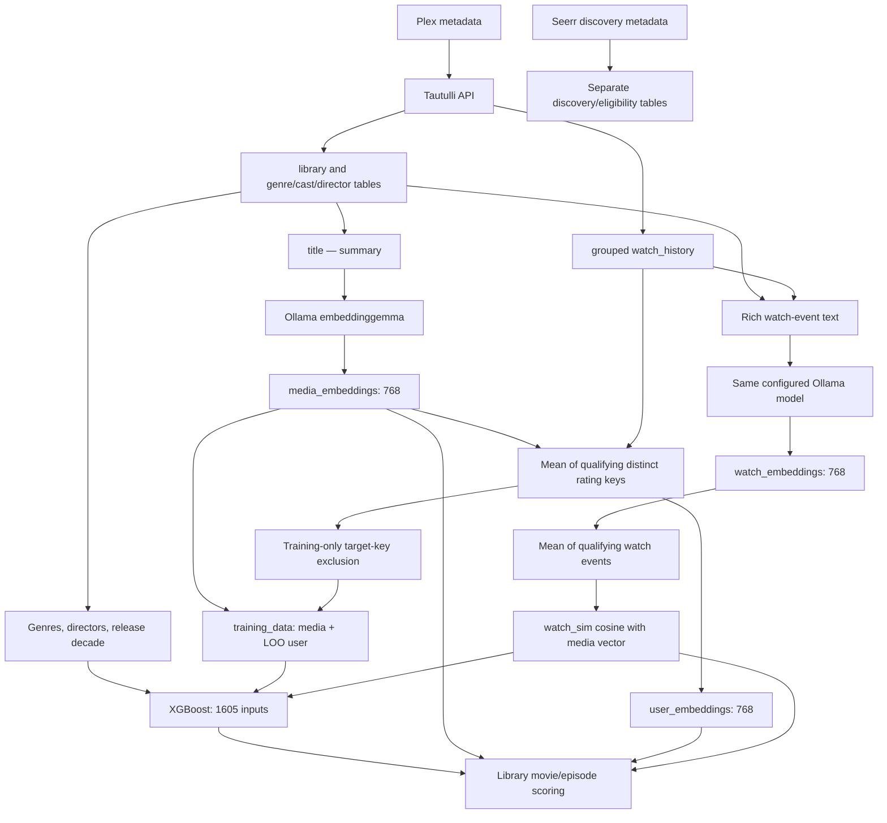

# Current media embedding architecture audit

## Executive Summary

**New media embeddings currently receive only `title — summary`. This is narrower than the historical implementation, and it does not describe all metadata used by prediction.** Genres, release decade, a separate rich watch-event similarity, and user profiles also enter the model. Cast has no direct categorical feature in the deployed classifier; director features exist but its trees do not use them.

The major findings are:

- **A verified historical reduction:** the November 18, 2025 Ollama migration replaced an `all-mpnet-base-v2` serializer containing title, year, genres, actors, directors, runtime and synopsis with title/synopsis. The commit documents the model migration, but not a quality or efficiency justification for removing fields. Whether that reduction was unintended is unknown.
- **No automatic invalidation:** normal incremental ingestion skips existing library keys. Media/watch embedding generation inserts missing keys only. Metadata or viewing-history corrections do not invalidate existing vectors. Embedding rows have no input hash, model digest, serializer version or timestamp.
- **Partial leakage protection:** the 768-dimensional training user profile excludes the current rating key. `watch_sim` uses a different, unrestricted watch-event profile that includes eligible target events. Neither profile is reconstructed as of the target date, and evaluation uses a random row split.
- **The deployed model has 1,605 features:** 768 media + 768 user dimensions, 38 genre flags, 20 director flags, 10 decade flags and `watch_sim`. Only 702 media dimensions and 530 user dimensions occur in tree splits. No direct actor flags exist; none of the 20 director flags occur in a split.
- **External discovery is separate:** Seerr metadata is persisted, but external titles have no production embedding/XGBoost scoring path. An unwatched title already in Plex is supported; an unseen TMDB discovery identity is not.

Richer metadata is a reasonable offline experiment, not an established recommendation-quality improvement. Fixing evaluation validity and defining provenance/invalidation should precede interpreting an embedding comparison.

## Scope and evidence

Audit date: **November 3, 2026, America/Chicago**. Primary database snapshot began at **08:58:28 CST**. Repository HEAD: `764b2ee3920026d49ba1ad5b3705a9b25255f122`. Code references below refer to this checkout at that HEAD.

Evidence is distinguished as **code** (static inspection), **observed** (read-only production queries/service information), **history** (Git), and **assessment** (implications rather than measured quality).

- **Observed deployment:** `plexintel-backend.service` was active, PID 1637, working directory `/home/jmnovak/projects/plexintel`; process working directory matched. Its relevant Ollama/batch environment values matched the resolved configuration. This establishes deployment location, not a byte-for-byte inspection of every module already loaded in process memory.
- **Observed execution history:** recorded scheduled pipeline run **325** succeeded November 3, **07:03:05–07:42:57 CST**. Its ingestion, media/watch embedding, user-profile, training-data, training, scoring and labeling stages all recorded success. These are existing run records; this audit did not execute them.
- **Observed model:** `xgb_model.pkl`, 347,694 bytes, SHA-256 `d812b3660aec406c3b77b77fe3bcf2132ede7be01ed7b98a175e17bd67ccf3af`, modified at **07:08:05 CST**. Inspection loaded the trusted local artifact and read feature names/tree structure only: no fit, predict, SHAP calculation or artifact write. The same hash appears in **18,536** retained prediction-context rows scored November 3, **07:09:00–07:39:18**.
- Database reads used `default_transaction_read_only=on`, explicit read-only transactions, bounded statement timeouts and rollback/close. Initial aggregate/parity collections used repeatable-read snapshots; follow-up collections are separately timed reads, not a single snapshot spanning all HTTP calls.
- Four bounded Tautulli `get_metadata` GETs inspected one movie, episode, season and show. Only key presence/nonempty state was retained. The earlier experiment's original Plex JSON was re-read for Plex-specific field availability; it is a same-day captured record, not a fresh all-library Plex census.
- Ollama `/api/version`, `/api/tags` and informational `/api/show` were read. **No inference, embedding generation, training, pipeline run, migration, configuration change, restart or commit occurred.** Only this report was added to the repository; temporary inspection helpers/evidence were placed in `/tmp`.

## End-to-End Data Flow



### 1. Acquisition and persistence

**Code:** [`tautulli_request`, lines 98–155](/home/jmnovak/projects/plexintel/api/services/tautulli_api.py:98) resolves endpoint/API-key settings and performs Tautulli GETs. PlexIntel's model-facing metadata importer does not directly fetch poster pixels or call Plex's metadata endpoint. Tautulli is its Plex metadata intermediary. Plex OAuth/user operations are separately implemented in [`plex_service.py`, lines 16–28](/home/jmnovak/projects/plexintel/api/services/plex_service.py:16).

[`get_library_media_info`, lines 150–196](/home/jmnovak/projects/plexintel/fetch_tautulli_data.py:150) paginates library listings; [`get_library_data`, lines 377–425](/home/jmnovak/projects/plexintel/fetch_tautulli_data.py:377) uses **section 1 for movies and section 2 for television**, then traverses show → season → episode with `get_children_metadata`. Each item's `get_metadata` result is projected into a small dictionary rather than retained as original JSON.

[`get_metadata`, lines 269–374](/home/jmnovak/projects/plexintel/fetch_tautulli_data.py:269) preserves title, summary, one numeric-style `rating`, added time, year, runtime, type, hierarchy, poster paths, Plex GUID, genres, actors and directors. Missing episode genres/cast fall back directly to the show; seasons similarly inherit from their show. Directors are not inherited by that fallback. Empty/failed metadata retrieval can trigger cache clearing in normal importer code; this audit deliberately used direct read-only GETs instead.

[`store_library_data`, lines 435–567](/home/jmnovak/projects/plexintel/fetch_tautulli_data.py:435) writes:

| Table | Relevant columns |
|---|---|
| `library` | `rating_key`, `title`, `summary`, `year`, `duration` (milliseconds), `rating` (text), `media_type`, `added_at`, `plex_guid` |
| `library`, TV context | `parent_rating_key`, `show_rating_key`, `show_title`, `season_number`, `episode_number`, `episode_title`, `episode_summary` |
| `library`, artwork | `thumb_path`, `parent_thumb_path`, `grandparent_thumb_path`; no image bytes |
| `genres` / `media_genres` | `id`, `name` / `media_id`, `genre_id` |
| `actors` / `media_actors` | `id`, `name` / `media_id`, `actor_id`, `cast_order` |
| `directors` / `media_directors` | `id`, `name` / `media_id`, `director_id` |

The deployed `library` has no original-title, tagline, writer, studio, country, original-language, content-rating, full-release-date, audience-rating, collection or keyword columns. Views can expose joins/derived fields; they do not add those missing base-table inputs.

Genre/director associations are insert-only; actor associations upsert cast order. There is no replacement/deletion of associations removed upstream, and an empty incoming list does not clear existing links. See [`store_genres`, `store_actors`, `store_directors`, lines 571–652](/home/jmnovak/projects/plexintel/fetch_tautulli_data.py:571).

Model-facing playback comes from **grouped `watch_history`**, not individual `watch_sessions`. [`persist_grouped_history`, lines 104–148](/home/jmnovak/projects/plexintel/api/services/watch_history_sync.py:104) enforces `grouping=1`; playback duration is seconds. Raw session/device/IP data is not selected by the embedding/training/scoring paths audited here. `watch_count` below means grouped history rows, not necessarily individual playback sessions.

### 2. Media input and model invocation

[`_media_text_for_embedding`, lines 108–117](/home/jmnovak/projects/plexintel/fetch_tautulli_data.py:108) is exactly:

```python
rk, title, summary = row
title = title or ""
summary = summary or ""
return f"{title} — {summary}".strip()
```

The selection is `library.rating_key, library.title, COALESCE(library.summary, '')`; the key is identity only. There is no explicit year, genre, actor, director, runtime, TV parent title, image, instruction prefix or structured metadata payload. A synopsis may naturally mention genre-relevant concepts or names; omission of a structured field does not prove absence of every related semantic concept.

For episodes, `library.title` is the **episode title**, and `summary` is its synopsis. The media input does not prepend `show_title`, season/episode identifiers or the show's synopsis. Show/season headers get their own vectors, but library scoring selects movies/episodes rather than those header vectors.

[`generate_media_embeddings`, lines 1250–1318](/home/jmnovak/projects/plexintel/fetch_tautulli_data.py:1250) calls [`embed_texts` / `_post_embed`, lines 41–104](/home/jmnovak/projects/plexintel/ollama_embeddings.py:41). The latter posts string lists to `/api/embed`, batches/retries, and returns vectors; it does not retain response timing/token metadata.

**Observed production configuration and installed model:**

| Item | Value / evidence |
|---|---|
| Ollama endpoint | `http://192.168.1.123:31770` |
| Server version | `0.40.13` |
| Configured model → installed tag | `embeddinggemma` → `embeddinggemma:latest` |
| Installed digest | `82f094e4c0e19bc4208c692996d4f1ecf14e82a8dee579ee1d2ca1175260058e` |
| Variant | `gemma-embedding`, 307.58M, BF16, llama.cpp runner; embedding capability |
| Declared model options | `num_ctx=2048`, `num_batch=2048`; output width 768 |
| Client batch size / timeout / keep-alive | 128 records / 300 seconds / `15m` |
| Retry policy | Initial attempt plus up to 3 retries; default backoffs 1, 2, 4 seconds |
| Configured thread hint | 16; sent as **top-level** `num_thread` |

The endpoint/model/thread/timeout/batch settings resolved from stored `env_bootstrap` settings; media/watch auto-embedding switches resolved true by default. Stored settings precede environment fallbacks in [`resolve_settings`, lines 1559–1647](/home/jmnovak/projects/plexintel/api/services/app_settings.py:1559).

The client does not send `truncate`, `dimensions` or an `options` object. The installed-version [Ollama request type, lines 598–623](https://raw.githubusercontent.com/ollama/ollama/v0.40.13/api/types.go) places runner options under `options`; top-level `num_thread` does not set that option. Therefore **16 configured threads is not evidence of 16 effective runner threads**. Default truncation may shorten over-context text; historical tokenization/truncation is not recorded. No truncation census or thread-utilization measurement was performed.

### 3. Normalization and storage

PlexIntel does not explicitly normalize new media/watch vectors in its client/writer. The installed-version [Ollama handler normalizes returned embeddings, lines 1273–1275 and 1328–1340](https://raw.githubusercontent.com/ollama/ollama/v0.40.13/server/routes.go). Stored media/watch norms are consistent with unit normalization; that does not identify their historical model versions.

| Observed table | Rows / non-NULL vectors | Width | Observed norm range |
|---|---:|---:|---:|
| `media_embeddings` | 8,393 / 8,393 | 768 | 0.99999932–1.00000076 |
| `watch_embeddings` | 9,586 / 9,586 | 768 | 0.99999932–1.00000085 |
| `user_embeddings` | 31 / 31 | 768 | 0.51940075–1.00000024 |
| `training_data.embedding` | 9,313 / 9,313 | 1,536 | Concatenation; not normalized as one vector |

The embedding tables contain **only** `(rating_key, embedding)`, `(watch_id, embedding)` or `(username, embedding)`, with `vector(768)` storage and primary keys on the identity. VectorChord L2 indexes exist; they are not the mechanism by which `score_model.py` selects or scores its full library candidate set. No non-internal triggers or rewrite rules were found on `library` or these three embedding tables.

## Metadata Utilization Matrix

**Legend:** `L` = model-facing library/association tables; `D` = separate `seerr_discovered_titles` inventory. `W` = richer watch-event text/profile used through `watch_sim`. A field reaching W is an **indirect historical-context signal**, not a field supplied for a prospective candidate. “Active” means used in at least one split of the current artifact, not an accuracy/causality claim.

**Unseen-title boundary:** every row's candidate statement distinguishes an unwatched **library** title from an **external discovery** title. The current scorer joins L + media/user vectors. D fields are available to a future adapter, but **none is served to the production classifier for external identities today**.

| Attribute | Plex/Tautulli availability | Actually persisted | Media embedding | Independent engineered feature | Current training / prediction use | Unseen title / other use |
|---|---|---|---|---|---|---|
| Title | Nonempty in all four Tautulli samples | L `title`; D `title` | **Yes** | No title category | Media/user dimensions; W | Library vector available; D title captured, not scored |
| Original title | Tautulli key; nonempty sampled movie | Not L; D `original_title` | No | None | No explicit path | D captured; unused by classifier |
| Summary / synopsis | Tautulli, populated in four samples | L `summary`, episode duplicate; D `synopsis` | **Yes**, full supplied string before server limits | None | Media/user dimensions; W first **400 characters** | Library text may be empty; D empty synopsis is common; no external scorer |
| Tagline | Tautulli key; sampled movie/show nonempty | Neither L nor D canonical/sanitized fields | No | None | Unused | Discarded by current ingestion |
| Genres | Plex/Tautulli; sample populated | L genre links; D JSON genres | No explicit genre field | 38 binary flags; 7 active | Direct flags + W | Library names filtered to artifact vocabulary; D IDs/names need mapping |
| Actors / cast | Plex/Tautulli; sample populated | L names/order; D cast JSON | No | **0 actor flags** in deployed model | W; actor tags retained in training data but excluded from direct X | Library cast available for W/labels/UI; D cast captured, not scored |
| Directors | Tautulli key; sampled movie/episode nonempty | L director links; D names and crew | No | 20 flags, **0 active** | W; direct flags present but unused by these trees | Known-vocabulary library flags constructed; D not scored |
| Writers | Tautulli key; sampled movie/episode nonempty | Not L; D crew jobs, when returned | No | None | Unused in X/W | D crew available for future extraction; no current writer input |
| Studio | Tautulli `studio`, populated samples | Not L; D production-company lists are related, not identical studio fields | No | None | Unused | Current studio discarded; D companies not scored |
| Release year | Tautulli; sampled season empty | L `year`; D year derivable from premiere date | No explicit field | 10 decade flags; only `is_2020s` active | Decade + W year | Library known-decade flags; no continuous year scalar |
| Original release / air date | Tautulli `originally_available_at`, populated movie/episode/show | Not L; D `premiere_date`, discovery date and movie release events | No | None | Unused by classifier | D dates used for discovery/eligibility scope; not interchangeable with library year |
| Country | Plex `Country` populated in captured movie; absent from four Tautulli top-level responses | Not L; D production-country JSON | No | None | Unused | D available; current model has no country input |
| Language | Plex stream language keys observed; no original-language top-level field in inspected Tautulli responses | Not L; D `original_language` | No | None | Unused by classifier | Original language used by discovery eligibility; audio/subtitle language is a different concept |
| Content rating / certification | Tautulli `content_rating`, populated samples | Not L; D movie release-event certification when returned | No | None | Unused | No classifier age-rating feature; not the numeric `library.rating` |
| Runtime | Tautulli milliseconds; sample populated | L `duration`; D movie `runtime` in minutes; TV episode-runtime metadata separate | No | **No direct runtime scalar** | Engagement denominator, label/profile qualification and candidate watched filter | Library runtime used in behavior filters; D runtime used in short-film eligibility |
| Critic/provider rating | Tautulli `rating`, sampled movie populated; sampled episode/show empty | L `rating` text; provider/source label discarded | No | None | **W only**, plus labels/UI | Candidate rating is not supplied directly to XGBoost; D vote average is a different measure |
| Audience rating | Tautulli `audience_rating`, sampled movie/episode/show populated | Not L; D `vote_average`/`vote_count` are distinct TMDB-style measures | No | None | No explicit path | Current Plex audience rating discarded; D votes not scored |
| Collections / franchises | Tautulli `collections` key; empty in four samples | Neither L nor D canonical projection | No | None | Unused as structured data | Technical key exists; real upstream population not established |
| Keywords / tags | Tautulli `labels` key; empty samples. A true provider keyword list was not verified | No L keyword/label table; no D keyword projection | No | None | Unused as structured data | Plex labels, genres and provider keywords must not be conflated |
| Poster reference / image | Tautulli `thumb` and hierarchy paths populated | L poster paths; D poster path within `source_metadata` | **No pixels or path** | None | Display/proxy only | No artwork input in production prediction |
| TV show identity / title | Tautulli parent/grandparent fields populated where applicable | L `show_rating_key`, `show_title`, parent key; D typed TV identity | **No explicit parent context for episode vectors** | None | W show/episode title; identities drive joins, filtering and display rollups | Library episodes scored; external TV series not adapted to episode-level scoring |
| Season / episode positions | Tautulli indexes populated | L positions; also `training_data`; D TV season metadata | No | **Not selected into X** | W `S…E…`; hierarchy/rollups | Stored positions are not numeric predictor columns |
| Media type | Tautulli populated | L `media_type`; D `(media_type,tmdb_id)` | No | No type one-hot | W type marker; movie/episode scoring selection | External typed IDs are separate from Plex rating keys |
| Added / updated times and IDs | Tautulli exposes added/updated time, GUIDs and keys | L `added_at`, rating key, Plex GUID; **not metadata `updated_at`**; D observation timestamps/fingerprint | No | None | Joins, acquisition/reconciliation and presentation; no freshness feature | No stored media-input freshness/version contract |

Matrix source paths: metadata projection/writers above; [`_watch_text_for_embedding`, lines 1321–1383](/home/jmnovak/projects/plexintel/fetch_tautulli_data.py:1321); [`process_row`, lines 200–339](/home/jmnovak/projects/plexintel/build_training_data.py:200); [`preprocess`, lines 260–398](/home/jmnovak/projects/plexintel/train_model.py:260); [`preprocess_for_scoring`, lines 537–630](/home/jmnovak/projects/plexintel/score_model.py:537); [`metadata_values`, lines 74–158](/home/jmnovak/projects/plexintel/api/db/seerr_discovery.py:74); [`_sanitize_title`, lines 183–307](/home/jmnovak/projects/plexintel/api/services/seerr_client.py:183).

### Actual population, not just schema capability

**Observed library counts** below use trimmed nonempty text, positive runtime, nonempty poster/rating text, and existence of metadata links. Link existence does not prove those links are current or complete upstream.

| Type | Rows / media vectors | Nonempty synopsis | Year | Positive runtime | Genres | Cast | Directors | Numeric-style rating text | Poster path |
|---|---:|---:|---:|---:|---:|---:|---:|---:|---:|
| Movie | 1,854 / 1,854 | 1,853 | 1,854 | 1,854 | 1,854 | 1,854 | 1,854 | 1,771 | 1,854 |
| Episode | 5,666 / 5,666 | 5,592 | 5,658 | 5,666 | 5,666 | 5,666 | 5,399 | 0 | 5,666 |
| Season | 581 / 581 | 581 | 15 | 579 | 581 | 581 | 0 | 0 | 581 |
| Show | 292 / 292 | 292 | 292 | 290 | 292 | 292 | 0 | 0 | 292 |

All 5,666 episodes have show/parent keys, show titles and season/episode positions. All 581 seasons have show/parent keys and season positions. Plex GUIDs are populated across all 8,393 rows. Cast order is populated for 989,337 of 1,003,792 cast links. Of 9,313 training rows, **67 reference a currently empty/missing synopsis**. They are not automatically rejected for text completeness.

**Observed discovery inventory:** 832 movies and 130 TV series. Nonempty synopsis exists for **685 movies and 80 TV series**, despite all 962 synopsis columns being non-NULL. Original titles/languages are nonempty throughout. Premiere dates: 803 movies / 125 series; canonical movie runtimes: 590 non-NULL values, with no series runtime scalar by design. Nonempty genres: 693 / 92; cast: 583 / 92; directors: 746 / 34; countries: 500 / 60; production companies: 425 / 61; poster paths: 687 / 108. These inventory fields **do not reach the production predictor**.

### Prediction features versus labels, similarities and presentation

[`train_model.preprocess`, lines 295–398](/home/jmnovak/projects/plexintel/train_model.py:295) stacks embedding values, multi-label genre/director indicators, decade indicators and `watch_sim`. Genres use all training-observed labels by default; directors use top 20 by training-row frequency. Episode-heavy series can therefore dominate director vocabulary frequency. Tag normalization splits comma-delimited strings and trims whitespace; it does not establish a canonical cross-provider ontology.

`release_year`, runtime, season/episode number, watched duration, engagement ratio, rating, title, identifiers and feedback strings are **not separately appended numeric/categorical columns**. Several are essential to labels, weights and row selection instead:

- [`build_training_data.process_row`, lines 245–339](/home/jmnovak/projects/plexintel/build_training_data.py:245): summed viewing time / current library runtime drives aggregate engagement. Watch-history positives use **≥0.60**; negatives require meaningful partial viewing, low aggregate ratio and expiration of the revisit-pending window. Intermediate/short/invalid-duration cases are skipped. Explicit four-state feedback overrides labels through `feedback_only_config`; rewatch count affects example weights, not continuous profile-vector weights.
- [`train_and_evaluate`, lines 541–640](/home/jmnovak/projects/plexintel/train_model.py:541): class balancing multiplies example weights, evaluates a stratified 80/20 random row split, then fits the final model on all rows. Threshold diagnostics do not change embedding content or the scoring ranking.
- [`get_unwatched_media`, lines 456–535](/home/jmnovak/projects/plexintel/score_model.py:456): scores library movies/episodes with both vectors, filters watched items using a 0.5 completion/runtime threshold and suppression feedback. It is not a never-played-only filter.
- [`score_and_store`, lines 748–759](/home/jmnovak/projects/plexintel/score_model.py:748): media/user cosine is stored separately and used for an explanation string above 0.85. **That cosine is not the `watch_sim` feature and is not an additional XGBoost input.** Ranking uses predicted probability.
- [`gpt_utils.get_media_metadata`, lines 1343–1422](/home/jmnovak/projects/plexintel/gpt_utils.py:1343) exposes title/year/type/show/rating/summary/runtime/genre/cast/director metadata for labeling/explanation workflows. Descriptive labels and poster presentation do not retroactively add fields to media vectors or predictions.
- [`global_eligibility.evaluate`, lines 75–116](/home/jmnovak/projects/plexintel/api/services/global_eligibility.py:75) uses discovery runtime, original language and genre evidence for eligibility rules, not XGBoost prediction.

## User Embedding Construction and Leakage Safeguards

### Persisted user preference profile

The active pipeline runs **`build_user_embeddings.py`**, which calls shared [`fetch_profile_title_rows` / `build_user_profiles`](/home/jmnovak/projects/plexintel/user_profile_embeddings.py:24).

1. Join grouped watch history to library runtime and media vectors.
2. Aggregate by `(username, rating_key)` over **all available history**. Qualify when `MAX(played_seconds / (duration_ms / 1000)) > 0.5` **or** grouped watch count ≥5.
3. Include one media vector per qualifying rating key and take an **equal arithmetic mean**. Engagement gates inclusion; it does not continuously weight the mean. Additional rewatches beyond qualification do not add copies of that title's vector.
4. Delete/rebuild `user_embeddings` and store the means. The active builder calculates a norm for logging but **does not normalize the mean**. [`build_user_embeddings`, lines 27–48](/home/jmnovak/projects/plexintel/build_user_embeddings.py:27).

“Title-level” here means **Plex rating key**. Each episode contributes independently; it is not one vote per TV series. Long watched series can contribute many profile entries. The repeat-count alternative can qualify short plays that never pass 50%; two current user/title pairs qualified solely through that alternative. Negative explicit feedback is not consulted by profile qualification, so a completed disliked title can still shape the mean even though feedback creates a negative training target.

**Observed:** all 31 stored user profiles matched read-only reconstruction from current qualifying media vectors (maximum L2 difference 0 at stored precision). Qualifying profile sizes ranged from 1 to 1,278 rating keys. This verifies arithmetic/current inputs, not each input vector's historical model provenance.

### Training versus scoring profile

[`add_leave_one_out_user_embedding`, lines 343–371](/home/jmnovak/projects/plexintel/build_training_data.py:343) uses [`leave_one_title_out`, lines 137–172](/home/jmnovak/projects/plexintel/user_profile_embeddings.py:137): subtract the current rating key if it qualifies; skip the row if nothing remains; otherwise use the mean of the other eligible vectors. A nonqualifying current key leaves the mean unchanged. Sibling episodes/seasons from the same show are not removed.

[`fuse_media_and_user_embedding`, lines 175–186](/home/jmnovak/projects/plexintel/user_profile_embeddings.py:175) validates finite, nonempty, equal-width vectors and concatenates **media first, user second**. Training casts to float32, then persists `vector(1536)`. Scoring uses the same ordering with the complete stored user profile, through [`preprocess_for_scoring`, lines 553–571](/home/jmnovak/projects/plexintel/score_model.py:553).

**Observed parity:** all 9,313 training media halves exactly matched current stored media vectors. A deterministic sample of up to eight rows per `(label,label_source)` stratum produced **34** rows; all user halves exactly matched independently reconstructed leave-one-rating-key-out means. This sample is evidence for that guard, not exhaustive proof for every training user half or historical run.

### Separate watch-event profile and `watch_sim`

Watch embeddings are **not** the persisted `user_embeddings` means. [`_watch_text_for_embedding`, lines 1321–1383](/home/jmnovak/projects/plexintel/fetch_tautulli_data.py:1321) serializes:

```text
[MEDIA_TYPE] show/episode or movie title SxEy (year) by username,
watched percent% for integer minutes.
Rating: ... . Genres: ... . Actors: ... . Directors: ... . Summary: first 400 characters
```

Actual optional fields are omitted when empty; this illustration shows the structure, not a literal stored row. Poster pixels are absent. The selected input includes the historical username and viewing outcome. This is an intentional behavioral description in code, but its recommendation value was not evaluated here.

[`build_user_watch_vectors`, lines 155–197](/home/jmnovak/projects/plexintel/build_training_data.py:155) averages qualifying **events**, with played/runtime **≥0.5**, without rating-key deduplication, target exclusion, recency weighting or time cutoff. Rewatches thus influence this mean by event frequency. `process_row` computes cosine between that mean and the target media vector. [`score_model.get_user_watch_vector`, lines 408–454](/home/jmnovak/projects/plexintel/score_model.py:408) reproduces the event-average rule; missing watch profiles yield `watch_sim=0`.

**Confirmed safeguard gap:** this watch mean is built once from full history before training rows are processed. The leave-one-title-out guard modifies only the concatenated user half. It does not remove the target's watch vectors from `watch_sim`.

| Current training source | Rows | Rows with an eligible watch event for their own target in the watch-profile pool |
|---|---:|---:|
| Watch-history positive | 6,155 | **6,134** |
| Watch-history negative | 646 | 0 |
| Explicit watched-like | 2,328 | 150 |
| Explicit reject | 182 | 23 |
| Explicit interest | 1 | 1 |
| Explicit watched-dislike | 1 | 0 |

The pool was independently counted from current history/runtime/vector joins. Stored watch-similarity values were not recomputed through model inference. The code establishes target-event inclusion; these counts establish its present opportunity. They do **not** quantify resulting metric inflation or recommendation harm. `watch_sim` is active in **25 tree splits**, so the gap is not confined to a discarded input column.

### Time-aware protection

There is **no as-of-target-date feature construction** in either profile query, no chronological train/test split, and no train-fold-only fitting of tag vocabulary. The training queries aggregate all history and latest feedback; `train_test_split` stratifies random rows. Other titles' later viewing, held-out titles, and later metadata can therefore contribute to training/evaluation profiles. The current target-key guard does not prevent these paths. The 14/21-day revisit-pending rule delays inferred abandonment labels; it is **not** a historical feature cutoff.

These limits matter especially for claims about prospective or unseen-title performance. Full-history profiles can be a deliberate retrospective preference-reconstruction design; this audit does not assume every retrospective use is invalid. Including the current target's own outcome-bearing watch event in `watch_sim` is a separate, directly identified exposure.

### Model-space compatibility

New media and watch vectors use the same configurable Ollama alias. User means derive from media vectors; dimensions are checked, and database widths agree. **Compatibility of all historical vectors cannot be verified.** No embedding row records which encoder digest/serializer created it, and an earlier encoder also returned 768 dimensions. Equal dimensions and unit norms cannot establish a shared model space. Model migration can leave old media/watch vectors in place, while rebuilding user means merely reuses them.

There is also legacy executable user-profile code in [`ollama_embeddings.py`, lines 219–284](/home/jmnovak/projects/plexintel/ollama_embeddings.py:219), which event-weights eligible media vectors and L2-normalizes its mean. Importing `embed_texts` does not run that `main`; the active pipeline invokes the separate title-deduplicated builder. It should not be mistaken for the deployed profile algorithm.

## Current Trained Model: Configured Versus Active Features

**Observed** by inspecting the saved booster's feature names and split usage, not by relying on defaults or a feature-importance screenshot:

| Feature group | Artifact input columns | Columns used by at least one split | Split count |
|---|---:|---:|---:|
| Media `emb_0`–`emb_767` | 768 | **702** | 2,182 |
| User `emb_768`–`emb_1535` | 768 | **530** | 1,265 |
| `genre_*` | 38 | 7 | 31 |
| `actor_*` | **0** | 0 | 0 |
| `director_*` | 20 | **0** | 0 |
| `is_*s` decade flags | 10 | 1 | 10 |
| `watch_sim` | 1 | 1 | 25 |
| **Total** | **1,605** | **1,241** | **3,513** |

Thus **1,536 is the concatenated vector width, not total model width**, and **304 of its embedding positions have no split usage in this artifact**. Inputs remain part of its contract even when unused. Split activity is not a measure of independent predictive value; correlated signals can substitute for one another.

Active genres: Animation, Comedy, Family, Fantasy, Sci-Fi & Fantasy, Science Fiction and Travel. The only active decade is `is_2020s`. All 20 retained director flags are inactive. Direct actor exclusion is deliberate: [`train_model.py`, lines 689–704 and 855–868](/home/jmnovak/projects/plexintel/train_model.py:689) makes actor inclusion experimental, noting TV/show-proxy behavior. Cast still reaches W and metadata/labeling paths.

Scoring aligns indicators to the artifact's vocabulary and reindexes all inputs to its feature order. New/unseen tag values become zero direct flags; they do not expand the saved model. The scorer also contains generic width padding/trimming at [`score_model.py`, lines 681–694](/home/jmnovak/projects/plexintel/score_model.py:681). Current widths match; silent alignment/filling is not a substitute for a serializer/model-space compatibility check if representations change.

## Embedding Lifecycle: Regeneration, Invalidation and Version Management

### What runs each day

[`build_pipeline_stages`, lines 758–765](/home/jmnovak/projects/plexintel/api/services/pipeline_service.py:758) and [`run_daily_pipeline.sh`, lines 73–93](/home/jmnovak/projects/plexintel/run_daily_pipeline.sh:73) order ingestion → missing media vectors → missing watch vectors → full user-profile rebuild → training-data rebuild → classifier retraining → scoring. Incremental ingestion can already generate missing media/watch vectors, so the subsequent explicit stages may find nothing to add. Turning off auto-embedding **during sync** does not remove those separately scheduled embedding stages.

[`run_incremental_load`, lines 721–793](/home/jmnovak/projects/plexintel/fetch_tautulli_data.py:721) reads existing library keys and queues only previously absent keys. Cache clearing before listing does not cause existing metadata to be refreshed. Missing header/GUID backfills are separate targeted exceptions, not change detection for all metadata.

| Change/event | Current media vector behavior | Derived consequences |
|---|---|---|
| New library key with no vector row | Embed current title/synopsis and insert | Available to future profile/training/scoring stages |
| Existing title/synopsis changed upstream | Ordinary incremental load skips its existing key | Library text can remain old; existing vector is reused |
| Existing metadata updated by full import/backfill/manual operation | Media writer still selects only absent vector keys | Current database text and vector can disagree |
| Genres/cast/directors changed | No media re-embedding; normal refresh also lacks association replacement | Direct flags/W may be stale; an existing W row is not regenerated either |
| Poster changed | No embedding effect | Artwork display only |
| Watch duration/completion corrected for existing watch ID | History can update; watch vector row remains | Stored event text may describe obsolete behavior |
| User history changes | Next active user-profile stage rebuilds all means | Reflects current qualifying **stored media vectors**, including any stale ones |
| Encoder alias/digest/serializer changed | Existing media/watch keys remain present and are skipped | Possible mixed spaces; dimension equality will not detect same-width changes |
| Explicit removal of a vector row | A later missing-key generation can fill it | There is no dedicated automatic content-change invalidation path |
| Existing vector row has NULL embedding | Key still exists and is not selected by missing-key query | Missing-key logic does not repair NULL values; none observed currently |

Watch generation is similarly missing-key-only: [`generate_watch_embeddings`, lines 1398–1498](/home/jmnovak/projects/plexintel/fetch_tautulli_data.py:1398). Recent grouped-history reconciliation changes duration/completion/date fields but does not invalidate W: [`persist_grouped_history`, lines 108–131](/home/jmnovak/projects/plexintel/api/services/watch_history_sync.py:108). Old deletion helper functions exist, but current [`sync_new_watch_history`, lines 1182–1221](/home/jmnovak/projects/plexintel/fetch_tautulli_data.py:1182) preserves locally retained history when absent upstream. They must not be interpreted as an active metadata-change refresh mechanism.

**Observed coverage:** zero orphan media vectors, zero orphan watch vectors, and zero history-to-library joined records missing a watch vector. Full key coverage is not evidence that inputs are fresh.

### What is versioned

[`dimension_config.build_metadata`, lines 6–18](/home/jmnovak/projects/plexintel/api/services/dimension_config.py:6) records media/user widths, expected positional ordering, embedding model **name**, full feature names and classifier SHA. [`persist_scoring_context`, lines 8–27](/home/jmnovak/projects/plexintel/api/services/dimension_scoring_context.py:8) attaches classifier/config identity to selected SHAP prediction contexts. The active layout is `8122a9b0a3c603941af1738d`, media 768/user 768, alias `embeddinggemma`, with the current classifier hash.

This is useful classifier/explanation provenance. **It does not version individual media/watch/user embedding rows, capture their input text, pin the encoder digest, or invalidate dependent artifacts.** The configured model name recorded during scoring cannot retrospectively prove the creator of an existing vector. Training data itself stores concatenated values without a build/as-of timestamp or serializer lineage.

## Training/Inference Consistency

| Question | Verified answer |
|---|---|
| Identical media generation at training and library scoring? | Both reuse `media_embeddings`; neither creates new media text during preprocessing. Current training media halves exactly match all joined stored media vectors. |
| Same profile rule? | Shared media-profile qualification; training excludes current rating key, production uses complete persisted mean. This is deliberate for a genuinely new title. |
| Same event-profile similarity rule? | Training/scoring both use ≥0.5 event-mean cosine; training lacks target exclusion and temporal isolation. |
| Unwatched library candidate? | Supported if library media vector and user profile exist. Missing summaries/tags/year have permissive fallbacks; no text-completeness admission gate. |
| External discovery candidate? | **Unsupported by the current predictor.** No embedding writer/feature adapter joins `seerr_discovered_titles` to training/scoring. |
| Retraining reuses embeddings? | Yes. Daily training data/classifier are rebuilt, while existing media/watch vectors are reused. |
| Can old metadata leave stale vectors? | Yes by construction; exact present stale-vector count is unknowable without retained input provenance or new comparison inference, which was not authorized/performed. |
| Can historical serializers/models differ? | Git proves different historic generators; row-level membership in those generations is unknown. |
| Missing data consistent? | Partly: empty title/summary are embedded; missing tags become empty lists and flags; missing year becomes all-zero decade flags. Media text lacks episode-summary fallback; W uses `COALESCE(summary,episode_summary)` (which does not treat empty string as NULL); labeling fallback can treat empty summary specially. |

Discovery metadata has richer explicit storage and fingerprints, but a different identity and granularity: TMDB movie/series versus Plex movie/episode. [`seerr_discovery.sync_discovery`, lines 143–172](/home/jmnovak/projects/plexintel/api/services/seerr_discovery.py:143), [`DiscoveryRepository` metadata columns, lines 23–32](/home/jmnovak/projects/plexintel/api/db/seerr_discovery.py:23), and [the documented future scoring boundary](/home/jmnovak/projects/plexintel/docs/content-lifecycle.md:115) establish that separation. This is an intentional current boundary, not evidence that external titles already get a poorer production embedding.

Legacy `all-mpnet-base-v2` code also remains in [`rag_routes.py`, lines 13–45](/home/jmnovak/projects/plexintel/api/routes/rag_routes.py:13) and standalone utilities. The RAG route's shown query does not apply its generated vector to similarity ordering; it is not an external-candidate XGBoost embedding path. No RAG inference was invoked.

## Design History: What Changed and What Is Documented

| History evidence | Verified behavior / interpretation |
|---|---|
| `c197314d3984dfa8d5516c3510a44992dd7bc6b2`, immediately before migration, `fetch_tautulli_data.py:873–932` | Effective `generate_media_embeddings` used `SentenceTransformer("all-mpnet-base-v2")`; selected year/runtime/genre/cast/director joins; text joined `title (year)`, genres, actor/director names, runtime minutes and synopsis with ` | `. |
| `756ec915595030a1d9737668d49b339313f24148`, November 18, 2025 | Commit message: “updated to retrofit support using embeddinggemma using local Ollama API”. Added `_media_text_for_embedding` and the Ollama client; effective later media generator selected title/synopsis only. It retained missing-key insertion semantics. |
| `git log -L :_media_text_for_embedding:fetch_tautulli_data.py` | The helper's title/synopsis expression dates to that migration; later relocation/refactoring did not re-add structured fields. The migration file briefly contained two definitions of `generate_media_embeddings`; the later Python definition also used the narrow helper. |
| `d0fc232`, May 15, 2026 | “Make no-actor training the production default…”; current CLI documents concern that direct actor indicators behave like TV/show proxies. This is documented intent for **direct actor flags**, not a rationale for omitting actors from media text in 2025. |
| `5e02fd3`, August 10, 2026 | Introduced shared distinct-rating-key profiles and leave-one-title-out construction. It does not add a chronological cutoff or target exclusion to `watch_sim`. |
| `845c007`, September 9, 2026 | Added dimension-layout/explanation provenance. It did not supply per-vector generation lineage. |

Reproduce the key historical comparison without checking out or changing files:

```bash
git show c197314d3984dfa8d5516c3510a44992dd7bc6b2:fetch_tautulli_data.py
git show 756ec915595030a1d9737668d49b339313f24148:fetch_tautulli_data.py
git log -L :_media_text_for_embedding:fetch_tautulli_data.py
```

**Documented:** encoder/runtime migration, deliberate later exclusion of direct actor indicators, and the later rating-key exclusion guard. **Not documented in the inspected history/docs:** an ablation, quality result, compatibility requirement or efficiency decision justifying narrow media input; a completed full-vector migration; or why narrowing was chosen. Fewer fields may reduce tokens, but that is an inference, not established design intent. The broader serializer demonstrably existed; whether the reduction was accidental cannot be established from the commit message.

## Findings

Severity describes the supported architectural exposure, not measured recommendation-quality loss.

### Confirmed architectural issues

| Finding | Severity and evidence |
|---|---|
| `watch_sim` target-event inclusion and non-temporal evaluation | **High for evaluation validity.** Full-history, outcome-bearing event profiles include eligible targets; 6,134 positive watch-history rows have their own eligible event in that pool; the feature is split-active. Random splitting and lack of time cutoffs are confirmed. Size of metric inflation is unmeasured. |
| No per-vector provenance or compatibility enforcement | **High for embedding-change safety.** Historic encoders/serializers differ, new calls use a mutable alias, and same-width old rows are accepted. Actual mixed-version population is unknown. |
| Metadata/history updates do not invalidate vectors | **Medium for freshness/correctness.** Existing keys are skipped; inputs can change without regeneration. No active triggers/rules provide another mechanism. Number of currently stale vectors is unknown. |
| Metadata associations accumulate rather than mirror source lists | **Medium for metadata fidelity.** Upstream removals/empty lists do not replace old genre/cast/director links. Actual stale-link count was not measured against a source census. |
| Configuration labels do not fully describe active logic | **Medium for reproducibility.** `training.engagement_threshold=0.7` is loaded but not used; actual watch-history positive threshold is hardcoded 0.60. `ENABLE_FEEDBACK` and `USE_SAMPLE_WEIGHT` are assigned but not referenced thereafter; feedback and weights are used unconditionally by the inspected paths. See `build_training_data.py:24–27,64,294–311` and `train_model.py:382–385,577–590`. Current true defaults do not expose the ignored-toggle behavior, but the controls do not govern those paths. |
| Thread hint is outside the documented request options | **Low for performance reproducibility.** Configured 16 is not an established effective worker count; actual runner threads were not measured. |

### Potential improvement opportunities

- **Recover explicit semantics missing from media vectors:** show context for episodes, genres, selected creator/cast fields and possibly year could help retrieval or prediction. Synopsis already implies some semantics; measured quality is unknown. Preserve an exact baseline and test ablations, rather than treating field count as quality.
- **Evaluate overlapping channels:** genre/year already have direct indicators; genres/cast/directors/year/rating already enter W. Richer media inputs can duplicate or overemphasize them and can indirectly bypass the rationale for excluding direct actor proxies. Director flags being unused does not prove directors have no semantic value.
- **Address missing context first:** 75 library records lack a nonempty synopsis; episode vectors do not explicitly identify their show. These are concrete input limitations; their effect should be stratified in evaluation.
- **Treat behavioral and descriptive embeddings separately in evaluation:** username and completed-viewing language are unnecessary for an intrinsic movie description and can encode identity/outcome artifacts in W. Test their contribution with target/time isolation before interpreting similarity as preference quality.

### Intentional design tradeoffs

- Direct actor flags are off by default with a documented show-proxy concern; optional actor experiments retain separate artifact names.
- Title-deduplicated user means prevent repeated watches of one rating key from continuously increasing its contribution. The ≥5-play inclusion exception remains explicit, and television is still episode-weighted across a series.
- Training's current-rating-key exclusion versus production's complete profile is deliberate. It is appropriate for a genuinely unseen key, but it is not complete leakage protection.
- Discovery acquisition/eligibility is explicitly separated from production scoring. Connecting it requires identity, movie-versus-series granularity, missing-data, vocabulary and time-of-availability contracts.

No documentary evidence establishes narrow title/synopsis media text as an intentional quality/efficiency tradeoff, so that claim is not made here.

### Unknowns requiring further investigation

- Which individual media/watch rows were created by each historic encoder/serializer, and whether a consistent full rebuild occurred after migration.
- Exact stale-vector/link counts and historical truncation; stored inputs/timestamps are absent.
- Amount of evaluation optimism caused by target/future history or sibling-show overlap; no new evaluation was run.
- Whether richer fields, artwork or alternative profile weighting improve recommendation quality across users, cold-start titles and sparse metadata.
- Effective Ollama runner threads and deployment-specific runtime performance; informational API reads do not establish those measurements.

## Recommendations — Prioritized, Not Implemented

1. **Make the offline evaluation trustworthy first.** Reconstruct both user-profile channels as of a defined prediction time; remove target-key events from W; separate training/validation chronologically and fit vocabulary within training folds. Include a show-grouped evaluation to measure sibling-episode effects. Compare corrected baseline metrics before making an embedding-quality claim.
2. **Specify a versioned embedding contract before changing inputs/models.** Record serializer version, canonical input hash, immutable encoder digest, dimensions, normalization and generated/as-of time. Enforce compatible generations across media, watches, user means, training snapshots and the classifier. Plan a consistent migration; do not infer compatibility from 768 dimensions or overwrite production vectors as an experiment.
3. **Define metadata refresh and dependency invalidation.** Detect existing-record changes, replace association sets with source-completeness safeguards, and invalidate only affected descriptive/event vectors and dependent profiles/training/scoring artifacts. History completion corrections need W invalidation too. Avoid coupling a mere poster update to text-vector regeneration.
4. **Run bounded, isolated text ablations before combining modalities.** Compare current title/synopsis, explicit TV context, selected genre/year/creator fields, and controlled cast inclusion under one encoder and a fixed corrected evaluation. Evaluate duplicate channels with/without W/direct flags, missing synopsis cohorts and new-title coverage. Quality, latency and storage are separate outcomes.
5. **Design external-candidate serving explicitly.** Normalize Seerr/Plex identity, tag vocabulary, units, missing-field state and series/episode granularity. Validate that only metadata known at the intended scoring time is supplied. Do not insert external IDs into library scoring tables as a shortcut.
6. **Reconcile configuration and implementation.** Make engagement/feedback/weight controls reflect actual code, verify thread options, and distinguish inactive legacy entrypoints. Preserve model-compatible baseline artifacts while evaluating any change.

Fields requiring particular caution: ratings/vote counts/popularity evolve after release and can add popularity bias; cast/studio/franchise signals can become near-identifiers; current metadata can leak future information into historical evaluation; watch completion/username are behavioral outcomes/identity rather than intrinsic content. Added semantic fields may help, duplicate existing signals, or reduce generalization. None of those quality outcomes was measured in this audit.

## Reproducible Read-Only Evidence Checks

Representative checks used for the reported conclusions (run inside an explicitly read-only transaction):

```sql
BEGIN TRANSACTION ISOLATION LEVEL REPEATABLE READ READ ONLY;
SET LOCAL statement_timeout = '30s';
SHOW transaction_read_only;

SELECT count(*), count(embedding),
       min(vector_dims(embedding)), max(vector_dims(embedding))
FROM public.media_embeddings;

SELECT count(*), min(vector_norm(embedding)), max(vector_norm(embedding))
FROM public.user_embeddings;

SELECT count(*) AS training_pairs,
       max(subvector(t.embedding, 1, 768) <-> m.embedding) AS max_media_distance
FROM public.training_data t
JOIN public.media_embeddings m USING (rating_key);

SELECT t.label, t.label_source, count(*) AS rows_with_target_event
FROM public.training_data t
WHERE EXISTS (
    SELECT 1
    FROM public.watch_history wh
    JOIN public.library l USING (rating_key)
    JOIN public.watch_embeddings we ON we.watch_id = wh.watch_id
    WHERE wh.username = t.username AND wh.rating_key = t.rating_key
      AND l.duration > 0 AND wh.played_duration IS NOT NULL
      AND wh.played_duration::float / (l.duration / 1000.0) >= 0.5
)
GROUP BY t.label, t.label_source;

SELECT config_id, active,
       metadata->>'embedding_model' AS embedding_model,
       metadata->>'model_sha256' AS classifier_sha256
FROM public.embedding_feature_config;

ROLLBACK;
```

For feature activity, the inspection read `joblib.load(BytesIO(model_bytes)).get_booster().feature_names` and `get_score(importance_type='weight')`, then counted input columns and nonzero split-use columns by prefix/index. It did not invoke a prediction. Additional aggregate checks inspected deployed schema/types, trigger/rule absence, source-field presence, coverage, current mean reconstruction and the 34-row leave-one-out sample. Secrets, raw private playback rows and vectors were not printed or embedded in this document.
