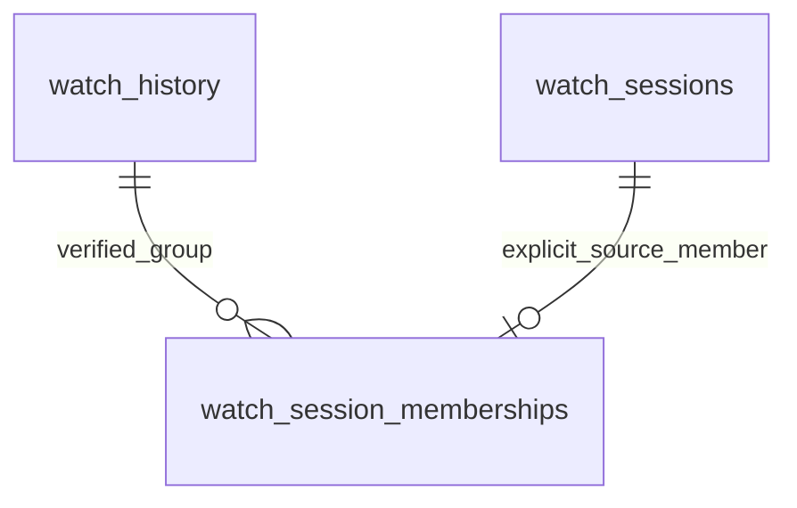

# Grouped watch history and raw playback sessions

## Contract and architecture

This implementation supersedes the original unapplied playback-metadata draft
and the grouping-related NO-GO finding. Model-facing `watch_history` remains a
**grouped** dataset. Raw Tautulli segments belong exclusively to `watch_sessions`.
No model/training/scoring/profile/embedding/exclusion code or artifacts changed.
This is isolation of data acquisition, not a change to predictive behavior.

The legacy writer continues updating only `played_duration`, `percent_complete`,
`watched_at`, and `show_rating_key` on conflict, as before this enhancement. All
other existing history values/relationships are retained. It now requires explicit
`source_grouping=1` and valid, complete `group_ids`/`group_count`; the HTTP path
pins `grouping=1`, matching the installed setting verified during review. Ordinary
upstream corrections to a grouped event can still update its aggregate duration;
individual raw durations never reach this writer. Replaying the identical grouped
response makes no physical update. There is no metadata-only history rewrite or
history deletion. A user/media identity mismatch is skipped rather than reassigned.



| Object | Meaning and identity |
| --- | --- |
| `watch_history` | Unchanged legacy grouped record; existing integer `watch_id` PK. |
| `watch_sessions` | Individual event; bigint `source_event_id` PK is Tautulli history `id`/`row_id`. |
| `watch_session_memberships` | `(watch_id, source_event_id)` PK and FK pair, with unique source_event_id to reject ambiguous assignments. |
| `watch_session_policy` | Singleton retention policy; 0 days disables IP collection. |
| `watch_history_playback_v` | Separate reporting sidecar with one row per grouped watch ID and six non-sensitive context fields. |

Sessions store source reference/user IDs, username/friendly name, media key/type,
source title, watched/started/stopped times (`timestamptz`), duration (seconds),
completion, `ip_address INET`, player/platform/product/device/version strings,
optional source session_id, and a durable IP-suppression timestamp. These fields
are nullable except source event ID and media key. No foreign key to media/user
catalogs: missing/deleted catalog objects must not prevent observing a session.
A source row with missing event/media identity is skipped. Empty/malformed context
preserves known values; an explicit null clears optional context. Session source
ID, user and media identity cannot be reassigned. Starts can be corrected earlier,
but cannot be moved later to rejuvenate IP retention.

`reference_id` is stored as an observation, **not** used as a watch_id or assumed
to be one-to-one. For example: raw IDs 100 and 101, reference 77, grouped watch ID
100, aggregate 1,800 seconds, individual segments 900 seconds each. Session
backfill writes the two 900-second observations, never the grouped 1,800-second row.

The source contract comes from
[Tautulli history SQL/projection](https://github.com/Tautulli/Tautulli/blob/master/plexpy/datafactory.py):
groups use reference_id, raw events use id, durations aggregate at the chosen
level, and `group_ids` explicitly lists members. A 2026-10-22 read-only installed
sample confirmed valid membership in 40/40 groups, 13 multi-session groups, and
matching reference IDs for all 58 raw members present in the overlapping sample.
13 group IDs differed from their source reference IDs. No source identifiers or
raw IP values were displayed. This design assumes one stable configured Tautulli
history database; switching servers/restoring/reusing source IDs requires a
separately reviewed namespace/reconciliation procedure.

## Independent ingestion

- `full`/`incremental`: existing grouped history path in `fetch_tautulli_data.py`
  calls `persist_grouped_history` in `api/services/watch_history_sync.py`.
- `watch-sessions-sync`: explicit independent raw-session sync; initial empty-table
  window is 30 days, subsequent windows reconcile 30 days before latest raw start.
- `watch-sessions-backfill`: explicit historical raw observation ingestion, with
  UTC `--since` inclusive and `--until` exclusive, paging and `--dry-run`.
- The old `watch-history-backfill` spelling is a deprecated alias for session-only
  backfill. It prints that fact; it cannot rewrite grouped history.

Raw modes require `WATCH_SESSIONS_DATABASE_URL`, a separate restricted writer DSN.
They reject superuser/role-administrator/RLS-bypass roles, model-table owners and
roles with table or column model-write permissions. The session module has no
history INSERT/UPDATE/DELETE statement, does not call grouped persistence, and
never invokes schema repair, library/user sync, cache clears, embeddings or model
jobs. The capability grants deny model-history writes at the database boundary.
A raw writer may SELECT only history ID/username/media for verifying associations.
Neither raw sync nor backfill is added to startup, deployment, or the daily pipeline.

After storing each raw page, the collector queries the **full** grouped source
records for its observed reference IDs, in batches of 50, without calendar filters
that could truncate group membership. It links only explicitly listed, already
stored sessions where the grouped ID/username/media match an existing legacy row.
Unmatched rows remain unassociated; missing grouped records are never inserted.
An advisory lock serializes membership refresh for a group. FK checks can acquire
short key-share locks, but do not modify model data. Conflicting ownership of a
source event fails the page rather than silently choosing another group.

Successful pages commit independently. SQL record failures restore savepoints and
increment failed counts; page-fetch/membership failures or interruption roll back
the current page and increment errors. Previously committed pages survive. Repeat
the same date window from offset zero; stable source IDs and distinct-value guards
prevent duplicates/unchanged rewrites. Dry run uses a server read-only transaction,
previews row outcomes, and rolls back; it does not refresh links or sweep IPs.
IP preview applies the same policy, including existing durable suppression.

Both retrieval modes explicitly exclude active sessions. API date bounds are
expanded by a day because Tautulli calendar filtering uses its timezone; raw UTC
bounds are rechecked locally. Raw until is frozen per invocation. Offset paging
still is not a snapshot: changing counts/repeated IDs abort; same-count mutations
or tied timestamps can still shift boundaries. Quiet windows and safe repeats
remain necessary. Grouped history reconciliation remains the existing configurable
30-day window (plus date rounding), not a promise of arbitrarily old corrections.

Grouped metrics report pages/API requests, rows, outcomes, watermark/fetch/
persistence/total seconds and commit/failure status. Raw modes report page,
insert/update/unchanged/skipped/failed, association, purge and error counts plus
total seconds. No source payloads/IP values are logged.

## IP policy and privilege boundaries

`watch_session_policy.ip_retention_days` defaults to **0 (off)** and accepts 0–365.
A database BEFORE INSERT/UPDATE trigger enforces it for raw ingestion, backfills,
and direct writes, even if application mapping is bypassed. Positive retention is
measured from the earliest known session start, using database time. Missing or
future starts fail closed. Old observations never retain incoming IPs.

Expired/disabled/purged IPs acquire `ip_suppressed_at`. The trigger preserves this
marker on every subsequent update, including a corrected recent timestamp or a
repeat historical backfill. Clearing a populated IP also suppresses it durably.
Rows initially collected with IP policy off stay suppressed if IP collection is
later enabled. The raw writer cannot delete observations, modify policy, disable
triggers, or clear suppression by normal updates. Do not delete/recreate rows as
an IP purge: doing so would discard the suppression evidence.

Every non-dry-run raw invocation sweeps expired IPs in all stored sessions, not
just its current date window. The partial index on starts with non-null IP makes
this sweep bounded by retained IP rows. The general start index supports raw
watermarks. `sql/purge_watch_session_ips.sql` supplies the same independent
maintenance operation and prints a count only. If enabling collection, the
operator must arrange an explicit purge schedule with a documented maximum delay
(e.g. hourly), including periods without ingestion. Between sweeps, expired bytes
can remain in storage; this is not an autonomous TTL service. Backup encryption,
expiry and restore/purge procedures must follow the same approved retention policy.
No IP collection setting or purge job was enabled during implementation.

The migration grants no PUBLIC access to the session tables/view/policy/trigger
function. `sql/provision_watch_session_roles.sql` is an **optional**, manually
executed capability-grant script, not an automatic migration. It creates two
NOLOGIN, non-superuser capability roles, never alters unrelated or existing
superuser services:

- `plexintel_session_writer`: session SELECT/INSERT/UPDATE, membership
  SELECT/INSERT/DELETE, policy SELECT, three history identity columns SELECT.
- `plexintel_history_reader`: explicit legacy reporting columns and the safe
  playback view only; no raw session/IP access or model writes.

Provision distinct LOGIN identities with operator-managed secrets and these roles.
Audit inherited role memberships and default privileges before granting access.
Superusers and table owners can still read raw data. The previously observed
unrelated `immich` superuser is an infrastructure blocker before positive IP
collection and is not automatically modified here. Capability roles do not cure
other inherited access or a global application superuser connection.

`WATCH_HISTORY_DATABASE_URL` optionally routes only REST/MCP history reads to the
restricted history reader in read-only transactions, without changing credentials
for unrelated backend routes. Connections close after the request. Its omission
preserves the existing connection path; operators must configure and verify the
restricted reader as part of the privilege cutover.

## Reporting, REST and MCP compatibility

**The migration does not replace or deparse `watch_history_enriched_v`, user views,
recommendation views or materialized views.** It does not add columns to, update,
or rebuild watch_history. New sessions are not joined into any model-facing view.
Only the new sidecar view joins sessions for application reporting. Existing view
column order, ownership, ACLs, object identity and definitions remain untouched;
no dynamic preservation/rebinding risk remains for those objects. The old 003
file is retained as an explicit no-op because it was an unapplied draft; use 004.
If an environment applied an earlier draft, leave its extra columns in place and
review their data/grants separately. This migration does not copy IPs from them,
remove them or rewrite their deployed views. Bootstrap `create.sql` establishes
the original grouped reporting contract for fresh installs only and includes 004.

`GET /api/agent/watch-history` and common MCP `get_watch_history` retain names,
parameters, UTC/pagination/engagement semantics, response envelope and six optional
context fields: player, platform, product, device, platform_version, product_version.
The query LEFT JOINs the sidecar by unique watch_id. The representative is the
verified member with latest started_at (NULL last), then highest source event ID.
All six fields come from that single member, including nulls; values are not
combined from several devices. No match means null metadata. Filters apply to
this representative, not ANY segment of a group. Limitations: devices can differ
across resumed sessions; only stored, verified members are candidates. This is
not a claim of complete source membership or of a group having one device.
A unique membership constraint plus a lateral LIMIT 1 prevents multiplying rows.
Raw source IDs, IPs, suppression state and session_id never appear in ordinary
REST/MCP responses. ChatGPT and Open WebUI still use the common MCP registration;
the deterministic Open WebUI adapter needs no changes. No frontend redesign.

MCP user-resolution/OAuth checks and existing REST scope/filter behavior are
preserved. **REST still has no principal authorization**: public Nginx ingress
has an allowlist, while direct backend anonymous requests could return all-user
history. New DB reader privileges do not fix this. Its separate authorization/
backend-reachability correction remains blocking for general deployment. Do not
interpret a `user` query parameter or MCP authentication as a REST security boundary.

The legacy reporting view intentionally remains unchanged, including its existing
metadata inner join (the prior review found 274 hidden stored events) and its
>=50% engagement label. Base history stores partial/zero-completion events; the
API filters engagement only when requested. Reporting completeness remains a
separate medium-priority issue; do not claim missing rows mean no playback.

## Operator runbook: prepared, not executed on production

1. Pause overlapping writers, back up the database/schema/ACLs, record counts and
   hashes of ordered legacy rows/model query outputs. Inspect source grouping=1,
   the watch_id unique key, deployed view definitions, role memberships and
   default privileges. A frozen production comparison must use identical source
   fixtures/snapshots; ordinary new upstream activity is not a regression.

   ```bash
   cd /home/jmnovak/projects/plexintel
   umask 077
   pg_dump "$DATABASE_URL" -Fc -f /secure/backup/plexintel-before-sessions.dump
   pg_dump "$DATABASE_URL" --schema-only -f /secure/backup/plexintel-before-sessions-schema.sql
   ```

2. Resolve the separate REST access blocker before exposing the new backend.
   Apply additive schema before backend code (old code ignores new objects):

   ```bash
   psql "$DATABASE_URL" -X -v ON_ERROR_STOP=1 --single-transaction \
     -f api/db/migrations/004_watch_sessions.sql
   ```

   This obtains brief DDL/FK locks with a five-second timeout; it does not rewrite
   legacy tables. Rerun safely if blocked. Do not apply `create.sql` to an existing
   database: older bootstrap statements contain DROP VIEW CASCADE.

3. Review and explicitly provision capability roles:

   ```bash
   psql "$DATABASE_URL" -X -v ON_ERROR_STOP=1 --single-transaction \
     -f sql/provision_watch_session_roles.sql
   ```

   Create separate LOGINs, set passwords through a secure channel (e.g. psql
   `\password`), and grant the respective NOLOGIN capability. Configure
   WATCH_SESSIONS_DATABASE_URL and WATCH_HISTORY_DATABASE_URL securely. Verify
   the writer is denied UPDATE/INSERT/DELETE/TRUNCATE on watch_history and the
   reader is denied SELECT ip_address FROM watch_sessions. Example LOGIN setup
   (names are illustrative; use operator-managed credentials):

   ```sql
   CREATE ROLE plexintel_session_ingest LOGIN INHERIT NOSUPERUSER NOCREATEDB NOCREATEROLE NOBYPASSRLS;
   GRANT plexintel_session_writer TO plexintel_session_ingest;
   CREATE ROLE plexintel_history_api LOGIN INHERIT NOSUPERUSER NOCREATEDB NOCREATEROLE NOBYPASSRLS;
   GRANT plexintel_history_reader TO plexintel_history_api;
   ```

   Set both passwords interactively with `\password`; never put them in shell
   history, command arguments, or this document. Audit shared superusers
   separately; never automatically downgrade unrelated running services.

4. Leave IP collection disabled until privileges, retention and backup policy are
   approved. For an explicitly approved 30-day policy, the operator may run:

   ```sql
   UPDATE public.watch_session_policy SET ip_retention_days = 30 WHERE singleton;
   ```

   Suppressed observations remain suppressed after enablement. Prepare an explicit
   hourly maintenance invocation using the restricted writer credential:

   ```bash
   psql "$WATCH_SESSIONS_DATABASE_URL" -X -v ON_ERROR_STOP=1 --single-transaction \
     -f sql/purge_watch_session_ips.sql
   ```

   No schedule or policy change is installed automatically. To disable IPs,
   set policy to 0 and immediately run the sweep. Preserve suppression markers
   and coordinate backups/restores so deleted IPs are not reintroduced.

5. Deploy the backend/host ingestion checkout only after schema and credentials
   are ready. For the checked-in Compose layout, prepared deployment commands are
   `docker compose build backend` then `docker compose up -d --no-deps backend`.
   Neither was executed. Update the host checkout used by ingestion independently.
   The MCP runtime is in the backend process; no separate Immich/Mealie
   restart is required. Verify existing history calls through the protected REST
   ingress and authenticated MCP clients, including another-user denial for
   ordinary MCP principals, unchanged durations/counts, six nullable metadata
   fields, fixed filters across pages and absence of IP/session IDs.

6. Explicit session commands (operator execution only):

   ```bash
   plexenv/bin/python fetch_tautulli_data.py --mode watch-sessions-backfill \
     --since 2026-01-01T00:00:00Z --until 2026-10-22T00:00:00Z --dry-run
   plexenv/bin/python fetch_tautulli_data.py --mode watch-sessions-backfill \
     --since 2026-01-01T00:00:00Z --until 2026-10-22T00:00:00Z
   plexenv/bin/python fetch_tautulli_data.py --mode watch-sessions-sync
   ```

   Omit since for all available sessions; use the same fixed dates after an
   interruption. Nonzero failed/errors produces exit status 1. Backfill never
   modifies grouped records, even for matching raw IDs. No source titles/IPs
   should appear in progress output. Do not use run_daily_pipeline.sh for this
   operation: it deliberately trains/scores. The CLI alias watch-history-backfill
   now targets sessions only; update operator scripts to the explicit new name.

7. Rollback code first; retain new tables/policy/suppression data. Old model code
   ignores them. Do not restore/overwrite legacy history merely to undo raw
   collection. A later removal of new objects/grants is a separately reviewed
   reverse migration after checking new dependents. Never DROP CASCADE against
   model/reporting objects. Prior mistaken ungrouped writes, if they occurred
   outside this implementation, require a verified pre-change backup/source
   reconciliation; this migration does not guess which durations to repair.

## Validation and remaining findings

Tests run actual SQL extracted from production sources against identical disposable
fixtures before/after initial and repeated raw ingestion, with two 900-second raw
segments corresponding to one 1,800-second legacy event. They compare:

- every legacy history column and row population;
- the actual training watch-aggregation query;
- actual user-profile SQL and calculated 768-dimensional profile means;
- actual watch-vector and pending-watch-embedding input queries;
- actual recommendation exclusion predicate and retained fixture scores;
- legacy view definitions, owner, ACLs and dependent/materialized outputs.

Separate tests cover grouping guards, raw identity updates/idempotency, missing
and explicit null metadata, real PostgreSQL savepoint failures, correct membership
and unassociated observations, deterministic tie-breaking/filtering without row
multiplication, read-only preview, interruption/repeat, default-off IP policy,
expired repeat backfill, future/missing starts, durable manual purge/sweeps, privilege
denials and reader-side IP exclusion. Fixture migration application is tested
idempotently. Existing REST/MCP/OAuth/Open WebUI and ML regression tests also run.
No production migration, CLI backfill/sync, training, scoring, embedding generation,
container deployment or daily pipeline was executed.

```bash
WATCH_HISTORY_TEST_DATABASE_URL=postgresql://jmnovak@localhost:55441/plexintel_watch_fixture \
  plexenv/bin/python -m pytest -q tests
```

The fixture refuses any database name except plexintel_watch_fixture and rebuilds
that dedicated public schema. Never use an application database. Dimension-explorer
integration requires its own EXPLORER_TEST_DATABASE_URL and may remain skipped.
Source-level isolation and fixture equality establish that the new session path
cannot change model inputs; they do not certify live deployment or future scores
under unrelated upstream changes.

| Finding | Status / deployment requirement |
| --- | --- |
| Forced ungrouped model history | Resolved by independent persistence and database role boundary; verified model-SQL equality. |
| IP rehydration on backfill | Resolved by default-off DB policy and sticky suppression; positive collection still requires approved operational purge/backup policy. |
| Dynamic deployed-view replacement | Removed. Existing deployed view definitions/ACLs are not touched. |
| REST all-user/direct-backend access | **Blocking**, separate authentication/scope/reachability change required. Preserved, not silently redesigned here. |
| Unrelated service superuser/global application access | **Blocking before positive IP collection**; separately authorize role/capability cleanup and dedicated-reader cutover. No automatic role downgrades. |
| Raw snapshot/offset races, older corrections | Medium, repeatable date windows/metrics; stronger snapshot/reconciliation strategy can be phased separately. |
| Legacy reporting hides missing catalog rows | Medium, defer a deliberate reporting-contract correction; do not claim complete event coverage. |
| Index/round-trip optimization | Defer pending observed grouped/session metrics; no speculative indexes on model history. |

Final validation (2026-10-22): **447 passed, 82 subtests passed, 11 skipped** in
15.48 seconds. Skipped cases require the separate dimension-explorer database;
the PostgreSQL session/migration/retention/isolation tests ran. One existing
FastAPI ORJSONResponse deprecation warning remains. `git diff --check` passed.
Protected feature, embedding, training/scoring source and xgb_model.pkl have no
diff. No production writes, backfills, model jobs or deployments were performed.

Principal changed files: `fetch_tautulli_data.py`,
`api/services/watch_history_sync.py`, `api/services/watch_session_sync.py`,
`api/db/migrations/003_watch_history_playback.sql` (superseded draft marker),
`api/db/migrations/004_watch_sessions.sql`, `sql/provision_watch_session_roles.sql`,
`sql/purge_watch_session_ips.sql`, `create.sql`,
`api/services/agent_tool_service.py`, `api/routes/agent_tools.py`,
`api/services/mcp_server.py`, `tests/test_watch_history_playback.py`,
`tests/test_tautulli_watch_reconciliation.py`, `tests/test_mcp_server.py`,
`tests/test_watch_history_rules.py`, and the two watch-history documents.
