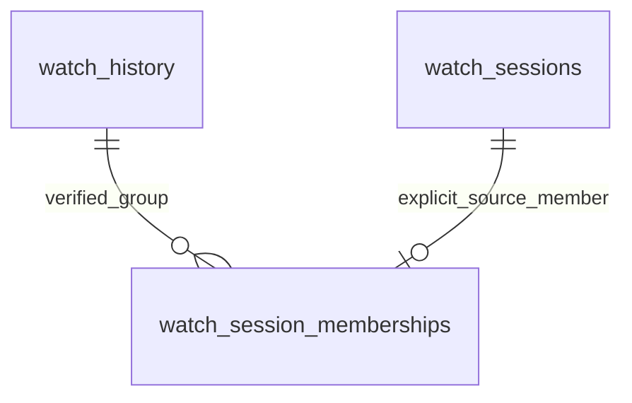

# Grouped watch history and raw playback sessions

## Contract and architecture

Migration 004 and the initial historical backfill are already applied in production.
Do not rerun them for this operational update. This implementation supersedes the
original playback-metadata draft and the grouping-related NO-GO finding. Model-facing `watch_history` remains a
**grouped** dataset. Raw Tautulli segments belong exclusively to `watch_sessions`.
No model/training/scoring/profile/embedding/exclusion code or artifacts changed.
This is isolation of data acquisition, not a change to predictive behavior.

The legacy writer continues updating only `played_duration`, `percent_complete`,
`watched_at`, and `show_rating_key` on conflict, as before this enhancement. All
other existing history values/relationships are retained. It now requires explicit
`source_grouping=1` and valid, complete `group_ids`/`group_count`; the HTTP path
pins `grouping=1`, matching the installed setting verified during review. Ordinary
upstream corrections to a grouped event can still update its aggregate duration;
individual raw durations never reach this writer. Replaying the identical grouped
response makes no physical update. There is no metadata-only history rewrite or
history deletion. A user/media identity mismatch is skipped rather than reassigned.



| Object | Meaning and identity |
| --- | --- |
| `watch_history` | Unchanged legacy grouped record; existing integer `watch_id` PK. |
| `watch_sessions` | Individual event; bigint `source_event_id` PK is Tautulli history `id`/`row_id`. |
| `watch_session_memberships` | `(watch_id, source_event_id)` PK and FK pair, with unique source_event_id to reject ambiguous assignments. |
| `watch_session_policy` | Singleton retention policy; 0 days disables IP collection. |
| `watch_history_playback_v` | Separate reporting sidecar with one row per grouped watch ID and six non-sensitive context fields. |

Sessions store source reference/user IDs, username/friendly name, media key/type,
source title, watched/started/stopped times (`timestamptz`), duration (seconds),
completion, `ip_address INET`, player/platform/product/device/version strings,
optional source session_id, and a durable IP-suppression timestamp. These fields
are nullable except source event ID and media key. No foreign key to media/user
catalogs: missing/deleted catalog objects must not prevent observing a session.
A source row with missing event/media identity is skipped. Empty/malformed context
preserves known values; an explicit null clears optional context. Session source
ID, user and media identity cannot be reassigned. Starts can be corrected earlier,
but cannot be moved later to rejuvenate IP retention.

`reference_id` is stored as an observation, **not** used as a watch_id or assumed
to be one-to-one. For example: raw IDs 100 and 101, reference 77, grouped watch ID
100, aggregate 1,800 seconds, individual segments 900 seconds each. Session
backfill writes the two 900-second observations, never the grouped 1,800-second row.

The source contract comes from
[Tautulli history SQL/projection](https://github.com/Tautulli/Tautulli/blob/master/plexpy/datafactory.py):
groups use reference_id, raw events use id, durations aggregate at the chosen
level, and `group_ids` explicitly lists members. A 2026-10-22 read-only installed
sample confirmed valid membership in 40/40 groups, 13 multi-session groups, and
matching reference IDs for all 58 raw members present in the overlapping sample.
13 group IDs differed from their source reference IDs. No source identifiers or
raw IP values were displayed. This design assumes one stable configured Tautulli
history database; switching servers/restoring/reusing source IDs requires a
separately reviewed namespace/reconciliation procedure.

## Independent ingestion

- `full`/`incremental`: existing grouped history path in `fetch_tautulli_data.py`
  calls `persist_grouped_history` in `api/services/watch_history_sync.py`.
- `watch-sessions-sync`: explicit independent raw-session sync; initial empty-table
  window is 30 days, subsequent windows reconcile the configured number of days before the latest raw
  start (30 by default; WATCH_SESSIONS_RECONCILIATION_DAYS accepts 1–365).
- `watch-sessions-backfill`: explicit historical raw observation ingestion, with
  UTC `--since` inclusive and `--until` exclusive, paging and `--dry-run`.
- The old `watch-history-backfill` spelling is a deprecated alias for session-only
  backfill. It prints that fact; it cannot rewrite grouped history.

Raw modes require `WATCH_SESSIONS_DATABASE_URL`, a separate restricted writer DSN,
loaded from the owner-only credentials file described below (or existing environment).
They reject superuser/role-administrator/RLS-bypass roles, model-table owners and
roles with table or column model-write permissions. The session module has no
history INSERT/UPDATE/DELETE statement, does not call grouped persistence, and
never invokes schema repair, library/user sync, cache clears, embeddings or model
jobs. The capability grants deny model-history writes at the database boundary.
A raw writer may SELECT only history ID/username/media for verifying associations.
Neither raw sync nor backfill is added to startup, deployment, or the daily pipeline.

After storing each raw page, the collector queries the **full** grouped source
records for its observed reference IDs, in batches of 50, without calendar filters
that could truncate group membership. It links only explicitly listed, already
stored sessions where the grouped ID/username/media match an existing legacy row.
Unmatched rows remain unassociated; missing grouped records are never inserted.
An advisory lock serializes membership refresh for a group. FK checks can acquire
short key-share locks, but do not modify model data. Conflicting ownership of a
source event fails the page rather than silently choosing another group.

Successful pages commit independently. SQL record failures restore savepoints and
increment failed counts; page-fetch/membership failures or interruption roll back
the current page and increment errors. Previously committed pages survive. Repeat
the same date window from offset zero; stable source IDs and distinct-value guards
prevent duplicates/unchanged rewrites. Dry run uses a server read-only transaction,
previews row outcomes, and rolls back; it does not refresh links or sweep IPs.
IP preview applies the same policy, including existing durable suppression.

Both retrieval modes explicitly exclude active sessions. API date bounds are
expanded by a day because Tautulli calendar filtering uses its timezone; raw UTC
bounds are rechecked locally. Raw until is frozen per invocation. Offset paging
still is not a snapshot: changing counts/repeated IDs abort the attempt; same-count mutations
or tied timestamps can still shift boundaries. Quiet windows and safe repeats
remain necessary. Grouped history reconciliation remains the existing configurable
30-day window (plus date rounding), not a promise of arbitrarily old corrections.

Grouped metrics report pages/API requests, rows, outcomes, watermark/fetch/
persistence/total seconds and commit/failure status. Raw modes report page,
insert/update/unchanged/skipped/failed, association, purge and error counts plus
total seconds, attempts/retries, reason counters and current global unlinked counts.
No source payloads/IP values are logged. One connection-level PostgreSQL advisory
lock, shared by sync/backfill/dry-run on every host, prevents overlapping raw runs.
All raw invocations must use this updated collector; an already running older
version cannot honor the new lock. Busy jobs return exit 75 without fetching or writing. Source/pagination failures
retry the same frozen date window from offset zero; WATCH_SESSIONS_RETRIES defaults
to 1 (range 0–2). Committed pages are safely replayed; outcome/request counters
can include those replays and are not unique-source totals. Unexpected database
failures are not automatically retried. A positive IP policy is rejected before
fetching/writing: this collector only supports the approved zero-day setting.

## IP policy and privilege boundaries

`watch_session_policy.ip_retention_days` defaults to **0 (off)** and accepts 0–365.
A database BEFORE INSERT/UPDATE trigger enforces it for raw ingestion, backfills,
and direct writes, even if application mapping is bypassed. Positive retention is
measured from the earliest known session start, using database time. Missing or
future starts fail closed. Old observations never retain incoming IPs.

Expired/disabled/purged IPs acquire `ip_suppressed_at`. The trigger preserves this
marker on every subsequent update, including a corrected recent timestamp or a
repeat historical backfill. Clearing a populated IP also suppresses it durably.
Rows initially collected with IP policy off stay suppressed if IP collection is
later enabled. The raw writer cannot delete observations, modify policy, disable
triggers, or clear suppression by normal updates. Do not delete/recreate rows as
an IP purge: doing so would discard the suppression evidence.

Every non-dry-run raw invocation sweeps expired IPs in all stored sessions, not
just its current date window. The partial index on starts with non-null IP makes
this sweep bounded by retained IP rows. The general start index supports raw
watermarks. `sql/purge_watch_session_ips.sql` supplies the same independent
maintenance operation and prints a count only. If enabling collection, the
operator must arrange an explicit purge schedule with a documented maximum delay
(e.g. hourly), including periods without ingestion. Between sweeps, expired bytes
can remain in storage; this is not an autonomous TTL service. Backup encryption,
expiry and restore/purge procedures must follow the same approved retention policy.
No IP collection setting or purge job was enabled during implementation.

The migration grants no PUBLIC access to the session tables/view/policy/trigger
function. `sql/provision_watch_session_roles.sql` is an **optional**, manually
executed capability-grant script, not an automatic migration. It creates two
NOLOGIN, non-superuser capability roles, never alters unrelated or existing
superuser services:

- `plexintel_session_writer`: session SELECT/INSERT/UPDATE, membership
  SELECT/INSERT/DELETE, policy SELECT, three history identity columns SELECT.
- `plexintel_history_reader`: explicit legacy reporting columns and the safe
  playback view only; no raw session/IP access or model writes.

The existing production session LOGIN already inherits its writer capability; do
not recreate it or rerun provisioning for this update. A reader LOGIN is optional
and has a separate procedure below. Audit inherited role memberships and default
privileges before granting access.
Superusers and table owners can still read raw data. The previously observed
unrelated `immich` superuser is an infrastructure blocker before positive IP
collection and is not automatically modified here. Capability roles do not cure
other inherited access or a global application superuser connection.

`WATCH_HISTORY_DATABASE_URL` optionally routes only REST/MCP history reads to the
restricted history reader in read-only transactions, without changing credentials
for unrelated backend routes. Connections close after the request. Its omission
preserves the existing connection path; operators must configure and verify the
restricted reader as part of the privilege cutover.

## Reporting and model compatibility

Migration 004 adds objects; it does not replace/deparse existing deployed views,
change their column order, ownership, ACLs or dependencies, or alter grouped rows.
No new migration is required for this update. Do not run bootstrap `create.sql`
against production: its legacy statements include DROP VIEW CASCADE.

REST `watch-history` and shared MCP `get_watch_history` retain the existing JSON
fields, envelopes, UTC date predicates, pagination and engagement semantics. Six
nullable context fields are available in compact/enriched results: `player`,
`platform`, `product`, `device`, `platform_version`, `product_version`. The LEFT
JOIN uses the sidecar's unique watch_id. One representative verified member is
chosen by latest started_at (NULL last), then highest source event ID; all six
values come from that member, including nulls. Exact player/platform/device
filters apply to this representative, not any session in a group. Missing session
metadata leaves the grouped result present. This does not imply complete source
membership or that resumed groups use only one device.

The legacy reporting view still inner-joins catalog metadata (the previous review
found 274 stored events hidden by missing metadata). Base history includes partial
and zero-completion events; >=50% is only the existing engagement/reporting rule,
with API engagement filtering opt-in. Do not infer no playback from incomplete
reporting. Raw IPs, source/session IDs and retention state are excluded from
ordinary REST/MCP output. No model SQL, feature engineering, training, scoring,
SHAP, rankings, exclusions or embeddings are changed.

## REST authentication and consumers

The `agent_tools` router now verifies identity before executing queries, including
when reached directly on port 8489. Nginx source allowlists remain defense in depth.
MCP authentication alone never authorizes a REST request.

- OAuth: reuses the existing Authentik JWT verifier, issuer, audience, signature,
  scopes and local email-to-Plex mapping. REST additionally requires an expiring
  access token and `plexintel.read`. Ordinary users are limited to their own
  history, recommendations, score and directory entry. Administrative entitlement
  comes from the mapped database user, not a request parameter or identity header.
- Browser: an existing signed Plex login session is checked against the database.
  REST accepts it only when the actual middleware signing key is at least 32
  characters and is not the development fallback. This is captured at startup.
  Browser feedback requires a matching Origin; OAuth feedback also requires
  `plexintel.feedback`. Feedback ownership is checked; read-service tokens cannot
  submit it.
- Unattended REST: optional owner-only token file, constant-time comparison and
  explicit `plexintel.read` / `plexintel.read_all` scopes. It is separate from the
  MCP shared key. `read_all` delegates cross-user reads to the entire trusted
  consumer; forwarded OpenWebUI email headers never narrow or establish identity.
  Grant it only if that consumer's users are allowed that scope. Otherwise use
  individually mapped OAuth access tokens.

Omitted REST user now resolves to the authenticated user. Global history requires
`all_users=true` and verified admin/service entitlement. A service without a mapped
username must specify a user or all_users; specifying both is invalid. A JWT
read_all claim alone does not promote a non-admin user. Anonymous/invalid/expired
credentials return 401, forbidden scopes/users 403, invalid scope combinations
400, unavailable identity/configuration services 503. Unexpected agent errors
return a generic 500 plus an incident identifier; logs retain incident, operation,
exception class and SQLSTATE, never exception text, SQL or credentials.

Repository consumer inventory:

| Consumer | Impact / rollout requirement |
| --- | --- |
| OpenWebUI deterministic REST pipeline | Previously sent no credentials. Updated adapter sends a SecretStr valve token or private token-file bearer on PlexIntel requests only, refuses missing credentials, disables redirects, sanitizes transport errors. Configure/update it before enforcing backend auth. Global workflows require explicitly approved read_all delegation. |
| ChatGPT / OpenWebUI shared MCP server | Calls services directly under existing MCP OAuth identity/scope handling; tool names and parameters unchanged. Existing MCP user resolution/multi-user rules remain. No new tool. |
| Browser frontend / admin pages | No calls to agent_tools found in repository. Their existing login/routes are unchanged. Direct REST use needs OAuth or a securely signed session. |
| Swagger/manual/external REST clients | Supply a bearer credential. Off-repository consumers cannot be inventoried here; operator must check ingress/client configuration before deployment. |
| OpenWebUI Sora integration | Separate `/api/agent/video...` router, unchanged. Its existing network-based perimeter needs a separate security review; this update does not secure every route under the prefix. |
| Public poster image route | Unchanged deliberately public image contract; agent poster-gallery requests now require authentication. |

Authenticated catalog/search/recent/gallery routes require read identity; user
personalization routes additionally enforce ownership. Client-side username
resolution is never an authorization mechanism.

## Verified production state (read-only, 2026-10-22)

| Metric | Observed |
| --- | --- |
| Grouped history / safe playback view rows | 9,717 / 9,717 |
| Raw sessions / memberships / unlinked | 4,438 / 4,412 / 26 |
| Session users | 28 |
| Player / platform / product populated | 100% / 100% / 100% |
| Stored IPs / retention days | 0 / 0 |
| Policy trigger | Enabled |
| Existing session login | plexintel_session_ingest; session INSERT/UPDATE allowed; history UPDATE denied |
| Existing capabilities | plexintel_session_writer, plexintel_history_reader |

The operator already backfilled January 1, 2026 onward: five source records were
skipped, no processing failures. Do not repeat that full backfill. These counts
are a dated baseline, not a promise that later activity leaves them fixed.

No private unattended session credential file or REST token file was configured
at review time. The application .env was not owner-only, and the actual browser
session key was absent/too short. The optional restricted reader LOGIN
`plexintel_history_api` was absent. No credentials, permissions or roles were
changed in production. The checked-in Compose file now requires the existing
DATABASE_URL from private .env instead of embedding an application password.

## Birch deployment runbook — commands prepared, not executed

### 1. Configure existing credentials privately

Run as jmnovak on Birch. The setup helper prompts invisibly for the **existing**
session password and Tautulli API key; it neither rotates credentials nor creates
accounts. It refuses overwrite, symlinks and public permissions. A private file
is necessary for unattended use; do not paste secrets into shell arguments.

```bash
cd /home/jmnovak/projects/plexintel
umask 077
plexenv/bin/python scripts/configure_watch_sessions.py
plexenv/bin/python scripts/configure_watch_sessions.py --check
```

Default file: `/home/jmnovak/.config/plexintel/watch-sessions.env` (directory 0700,
file 0600). It contains WATCH_SESSIONS_DATABASE_URL, TAUTULLI_API_URL/KEY,
WATCH_SESSIONS_RECONCILIATION_DAYS=30 and WATCH_SESSIONS_RETRIES=1. The loader
accepts only those keys and never overwrites the application DATABASE_URL.
`--check` opens a read-only connection, verifies the existing restricted login,
database, model-write denial, zero policy, empty IP column and enabled trigger.
For a nondefault path set WATCH_SESSIONS_CREDENTIALS_FILE; update the unit too.
Environment-only configurations remain supported when the default file is absent.

Ensure `.env` contains the exact existing application DATABASE_URL (unchanged
credential) before Compose deployment. Secure it, without printing it:

```bash
chmod 600 .env
```

Do not rotate the existing session signing key as part of this update. If browser
REST sessions are needed, separately approve setting a strong SESSION_SECRET and
its potential logout impact, then restart the backend. Until then that REST auth
method fails closed; OAuth and scoped service credentials remain available.

### 2. Prepare the REST consumer and backend together

Use OAuth where a per-user access token can be supplied. For the existing trusted
multi-user deterministic pipeline, create one private service token offline,
only if its cross-user delegation policy is approved:

```bash
plexenv/bin/python - <<'PYTOKEN'
from pathlib import Path
import os, secrets
p = Path('.secrets')
p.mkdir(mode=0o700, exist_ok=True)
if p.stat().st_mode & 0o077:
    raise SystemExit('Secure the existing private directory first')
fd = os.open(p/'agent-rest.token', os.O_WRONLY|os.O_CREAT|os.O_EXCL|os.O_NOFOLLOW, 0o600)
with os.fdopen(fd, 'w') as f:
    f.write(secrets.token_urlsafe(48)+'\n')
print('Created private token; no secret displayed')
PYTOKEN
```

Set these nonsecret settings in backend private `.env`:

```dotenv
PLEXINTEL_AGENT_SERVICE_TOKEN_FILE=/app/.secrets/agent-rest.token
PLEXINTEL_AGENT_SERVICE_SCOPES="plexintel.read plexintel.read_all"
```

Existing Compose repository bind mounting provides the file; it is excluded from
Git and Docker build context. Transfer the same credential through an approved
private channel to an owner-only file readable by the OpenWebUI pipeline runtime,
set its PLEXINTEL_API_TOKEN_FILE to that runtime's path, or populate its
PLEXINTEL_API_TOKEN SecretStr admin valve. Neither requires exposing a token to
end-user messages. Do not log it. Do not use forward-email headers as identity.

Install/reload the modified deterministic adapter and configure its credential
**before** deploying the backend enforcement. The previous backend ignores the
extra bearer header; an old adapter after enforcement fails with a clear 401.
Test at least personal history, authorized global history, recommendations,
catalog search and poster gallery. OAuth tokens expire; the unattended service
file does not implement OAuth refresh and must not contain an expiring user token
if indefinite unattended access is intended.

### 3. Optional restricted reader cutover

Existing capability roles and the session LOGIN must not be recreated; do not
rerun 004 or capability provisioning scripts. For defense in depth, a separately
approved DBA session can create the currently absent reader login:

```sql
CREATE ROLE plexintel_history_api LOGIN INHERIT NOSUPERUSER NOCREATEDB NOCREATEROLE NOBYPASSRLS;
GRANT plexintel_history_reader TO plexintel_history_api;
\password plexintel_history_api
```

Use `psql -X` through an existing secure administrator connection and interactive
password entry; confirm absence first. Audit inherited/default privileges. Store
its DSN as WATCH_HISTORY_DATABASE_URL in private backend .env. Verify history
reads succeed and raw IP/model writes fail. This switches only REST/MCP history
reads, not unrelated application connections. It is optional for zero-IP
operation, recommended hardening; it does not replace REST identity enforcement.

### 4. Deploy backend only after the prerequisites pass

```bash
cd /home/jmnovak/projects/plexintel
docker compose build backend
docker compose up -d --no-deps backend
```

This restarts the integrated FastAPI/MCP backend, not a separate MCP container.
The host raw collector does not need an application restart. Verify public ingress
and direct backend access independently (the external allowlist can deny earlier
than REST, in which case record that and run identity probes from an allowed
source). The read-only helper prints only statuses, not response payloads:

```bash
plexenv/bin/python scripts/verify_agent_access.py --base-url http://127.0.0.1:8489
plexenv/bin/python scripts/verify_agent_access.py --base-url https://plexintel.kabolly.com \
  --service-token-file .secrets/agent-rest.token --ordinary-jwt
```

Expect anonymous/spoofed-header 401, ordinary self 200, cross-user/all-user 403,
explicit entitled service all-user 200. Use an existing ordinary OAuth token at
the invisible prompt. Also test an admin token and pagination/date/context filters
with the same scope across pages. Through **both** actual ChatGPT and OpenWebUI
MCP clients reconnect/discover tools; check own history, unauthorized cross-user
denial, authorized multi-user workflows, nullable context and absent IP/IDs. Source
and fixture tests do not replace these post-deployment client checks.

### 5. Approve one independent sync smoke test, then the timer

First run the credential helper --check. After explicit operator approval:

```bash
plexenv/bin/python fetch_tautulli_data.py --mode watch-sessions-sync
```

No full historical backfill is needed. Record elapsed time, pages, outcomes and
unlinked reasons. Compare grouped history/model-query snapshots with no concurrent
legacy writer; sessions must not change them. Repeat only if investigating a
failure or idempotency concern. Never substitute run_daily_pipeline.sh.

Prepare/install the units, without starting the service:

```bash
sudo install -m 644 deploy/systemd/plexintel-watch-sessions.service /etc/systemd/system/
sudo install -m 644 deploy/systemd/plexintel-watch-sessions.timer /etc/systemd/system/
sudo systemctl daemon-reload
systemd-analyze verify /etc/systemd/system/plexintel-watch-sessions.service /etc/systemd/system/plexintel-watch-sessions.timer
```

After explicit approval to enable scheduling:

```bash
sudo systemctl enable --now plexintel-watch-sessions.timer
systemctl list-timers plexintel-watch-sessions.timer
```

Cadence is daily 04:15 America/Chicago plus up to five minutes jitter; Persistent
catches missed runs after downtime. Change through `sudo systemctl edit
plexintel-watch-sessions.timer` with `[Timer]`, an empty `OnCalendar=`, then the
new `OnCalendar=...`, followed by daemon-reload and restart of the timer. Unit runs
as jmnovak with owner-only umask, read-only home/system, private tmp, no new
privileges, 45-minute timeout and SIGINT cleanup. It does not call any model job.

### 6. Monitor and recover

```bash
systemctl status plexintel-watch-sessions.timer plexintel-watch-sessions.service
journalctl -u plexintel-watch-sessions.service --since '2 days ago' --no-pager
systemctl show plexintel-watch-sessions.service -p Result -p ExecMainStatus
```

Exit 0 means success, 1 means failed/errored, 75 means another raw job owns the
lock (treated as successful skip by systemd, `busy=true` in stats). Monitor stale
latest session timestamps as well as failures: a busy skip is not freshness.
Diagnostics expose counters/durations, skip and association reasons, not personal
playback values. The unlinked reason totals describe the **current entire table**:
missing_source_reference or no_verified_group_membership. Page reasons distinguish
missing grouped history/identity mismatches and malformed/identity-conflicting
source rows. They need not match the old five skipped rows after new source data.

A source/pagination failure receives bounded in-process retries with frozen dates;
committed pages remain. Rerun sync after connectivity is restored. An explicitly
initiated backfill should repeat its same fixed --since/--until window from offset
zero. Do not delete rows or manually reset suppression. Interruption releases the
connection advisory lock; broken connections release it at PostgreSQL. A hard
systemd kill can lose only the current uncommitted page. Do not defeat the lock.

Each row currently incurs savepoint/existence/upsert work; unchanged records use
IS DISTINCT FROM guards and do not perform physical updates. The 30-day overlap
and bounded retries limit ordinary work but are not a snapshot guarantee. Same-
count source mutations/tied ordering can still escape offset checks. Inspect
measured durations before increasing cadence/window; optimize batching/indexes
only if observations justify it. No new production execution duration is claimed:
no sync was executed for this operational update.

### 7. Roll back safely

```bash
sudo systemctl disable --now plexintel-watch-sessions.timer
```

Stopping a timer does not stop an already running service; inspect status and
allow completion or interrupt it cleanly before changing collector code. Revert
backend and adapter together if necessary, preserving ingress restrictions;
reverting REST auth reopens the previous direct-backend weakness. Retain session
objects, privileges, credentials and suppression evidence. Do not drop/recreate
objects, restore grouped history, rerun initial backfill, or rotate credentials as
a rollback shortcut. A separate reader cutover can be reversed by removing only
WATCH_HISTORY_DATABASE_URL and restarting; other application DSNs stay unchanged.

## Privacy prerequisites and deferred findings

IP collection remains OFF. No commands here enable it. The collector now refuses
a positive policy before source access. Before any future collection, separately
approve restricted application/reader credentials, unrelated-superuser access
review, backup encryption/expiry/restore-purge controls, a maximum purge delay and
independent purge schedule. The existing trigger and sticky suppression prevent
repeat backfills from rehydrating purged addresses; privileged owners/superusers
can bypass controls and must be governed separately. Do not alter unrelated
service roles automatically.

| Finding | Assessment |
| --- | --- |
| Anonymous REST history / related private agent routes | Fixed in source; deployment/credential/client checks remain blocking before production activation. |
| Missing unattended credential and pipeline entitlement | Blocking for unattended rollout; operator setup required, not automatically performed. |
| Weak existing browser signing configuration | Browser REST deliberately disabled; strong key and restart required only if this method is used. |
| Positive IP collection | Out of scope and blocked pending the separate controls above. |
| Offset races / corrections older than configured overlap | Documented bounded-retry limitation; defer stronger snapshots and targeted old backfills. |
| Legacy missing-catalog reporting rows | Deferred medium issue; preserved contract, do not claim full event coverage. |
| Unrelated Sora perimeter / off-repository clients | Separate review/inventory required; no claim all application routes are secured. |
| Reader login / existing broad application DB privileges | Recommended separate hardening with zero IPs; blocker before collecting IPs. |

## Automated validation

Tests compare identical disposable fixtures before/after raw ingestion and retries:
every grouped row/column, actual training watch aggregation SQL, user-profile SQL
and 768-dimensional profile means, watch-vector/pending-embedding input queries,
recommendation exclusions and retained fixture scores. Existing view definitions,
owners, ACLs and dependencies remain equal. Session tests exercise PostgreSQL
idempotency/updates/memberships/one-row reporting/retention/suppression/privileges,
overlap exclusion, interrupted retries and role/policy preflight. REST tests cover
anonymous/spoofed identity/expired/wrong issuer/audience/scope, self/cross/admin/
service authorization, CSRF and sanitized errors. Existing shared MCP OAuth/tool
and deterministic pipeline suites remain included.

Use only the dedicated disposable fixture database; tests reject another name
and rebuild its public schema. Never set this variable to production:

```bash
WATCH_HISTORY_TEST_DATABASE_URL=postgresql://jmnovak@localhost:55441/plexintel_watch_fixture \
  plexenv/bin/python -m pytest -q tests -o faulthandler_timeout=40
```

Dimension explorer tests require a separate EXPLORER_TEST_DATABASE_URL and may
remain skipped. Actual deployed clients, production job duration and schedule
activation require operator verification; they were not executed here.

Final source validation, 2026-10-22: **484 passed, 82 subtests passed, 11 skipped**
in 16.29 seconds. Skips require the separate dimension-explorer database; all
PostgreSQL session tests ran. One existing ORJSONResponse deprecation warning
remains. `git diff --check` passed, and systemd unit/calendar syntax validation
passed. Training/scoring, MCP server/authentication, model artifact and daily
pipeline files have no diff. No production migrations, writes, credential changes,
sync/backfill, model jobs, container deployments or timer activation were executed.

Files changed in this operational update:

- REST: `api/main.py`, `api/routes/agent_tools.py`,
  `api/services/agent_auth.py`, `api/services/agent_tool_service.py`.
- Independent collector/configuration: `api/services/private_config.py`,
  `api/services/watch_history_sync.py`, `api/services/watch_session_sync.py`,
  `fetch_tautulli_data.py`, `scripts/configure_watch_sessions.py`,
  `scripts/verify_agent_access.py`.
- Consumers/deployment: `openwebui_pipelines/plexintel_recommendation_pipeline.py`,
  `docker-compose.yml`, `.gitignore`, `.dockerignore`,
  `deploy/systemd/plexintel-watch-sessions.service`,
  `deploy/systemd/plexintel-watch-sessions.timer`.
- Tests: `tests/test_agent_rest_auth.py`, `tests/test_session_operations.py`,
  `tests/test_agent_tools_routes.py`, `tests/test_watch_history_compact.py`,
  `tests/test_watch_history_playback.py`, `tests/test_watch_history_rules.py`.
- Documentation: this runbook, `docs/watch-history.md`,
  `docs/openwebui-mcp-oauth-setup.md`.

Assessment: **GO for an operator-controlled staged deployment once credential and
consumer prerequisites are satisfied; NO-GO for unattended activation in the
currently observed configuration.** Live REST/MCP checks and the approved sync
smoke test must pass before the timer is enabled.
